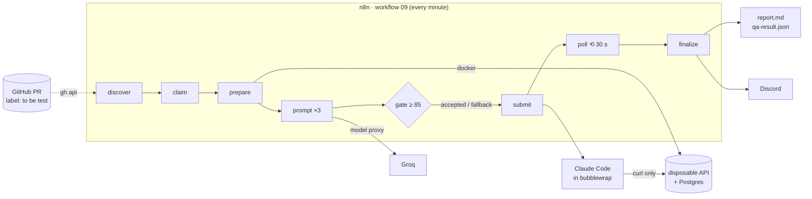

<div align="center">

# PRQA · PR QA Pilot

**Label a pull request. Get it tested against a live copy of its own API. Read the verdict in Discord.**

[](pyproject.toml)
[](n8n/trigger/README.md)
[](scripts/pipeline/prqa_local_opencode.py)
[](docs/GROQ_MIGRATION.md)
[](compose/docker-compose.yml)
[](pyproject.toml)



</div>

---

## What it does

Add the label **`to be test`** to a pull request and PRQA, without anyone pressing anything:

1. **Checks out the PR's exact head commit** and boots a disposable copy of its API with its own Postgres.
2. **Writes a QA plan for that PR**: Groq reads the diff, the description and the OpenAPI spec in three staged calls.
3. **Grades the plan** with an 85-point rubric and hard-fail rules, and swaps in a reference plan if it is not good enough.
4. **Runs the plan with Claude Code** inside a bubblewrap sandbox that can reach nothing but that disposable API.
5. **Reports**: `report.md` + a schema-validated `qa-result.json`, then a summary with every defect posted to Discord.
6. **Cleans up**: the environment is destroyed. A commit is never tested twice.

> A recorded example: PR #2 of `Kiramido1/Amenly-Product` was tested in ~7 minutes. Out of 30 scenarios, 14 passed,
> 11 failed and 5 did not apply. Among the 11 defects: `calc` answered `1e308 + 1e308` with HTTP 200 and `result: null`,
> and `password-strength` echoed the plaintext password plus an unsalted MD5 hash.

## How a run flows



| Stage | What happens | Owner |
|---|---|---|
| **discover** | Lists open PRs with the label that were not yet tested at their head SHA | `scripts/pipeline/prqa_label_poller.py` |
| **claim** | Reserves the run key `(repo, PR, SHA, policy)` under an exclusive state lock | `prqa_stages.py` |
| **prepare** | Clones the PR head, starts the API + Postgres, reads OpenAPI, builds the prompt context | `prqa_disposable_env.py` |
| **promptstep** | Three Groq calls (scope → coverage → sections), each validated, within the shared 8,000 TPM budget | `worker/prqa_worker/prompt_stages.py` |
| **gate** | Rubric score ≥ 85 and zero hard fails, otherwise the deterministic reference prompt | `worker/prqa_worker/qa_rubric.py` |
| **submit / poll** | Starts Claude Code in the sandbox (groups of 3 scenarios per session); polls every 30 s, 90 min limit | `prqa_local_opencode.py`, `worker/sandbox/chunked_run.py` |
| **finalize** | Writes the report, tears the environment down, posts to Discord | `prqa_auto_runner.py`, `prqa_discord_delivery.py` |

Every stage that blocks (gate rejected, environment failed, head moved) finishes the run itself, with the same cleanup and
Discord message. A valid result is kept even if the runner fails afterwards.

**Interactive map:** open [`docs/diagrams/system-architecture.html`](docs/diagrams/system-architecture.html) in a browser
and press **Start simulation** to watch the recorded run travel through every component, with a live log.

## Quick start

```bash
make install   # once: Docker, gh, Poetry env, Claude Code CLI, images (skips what is already there)
make run       # start everything and check readiness (after every reboot)
```

When `make run` prints **ready**, add the label `to be test` to a PR of the connected repository. n8n picks it up within a minute.

| Command | What it does |
|---|---|
| `make install` · `make check-install` | Install what is missing · report only |
| `make run` · `make stop` · `make restart` | Start (recreates containers, bridge service, workflow 09) · stop (data kept) · both |
| `make status` | Prerequisites, eligible PRs and processed runs (read-only) |
| `make preview PR=N` | Build and gate the prompt for one PR without running it |
| `make ps` · `make logs [S=service]` · `make bridge-logs` | Container states · container logs · n8n bridge log |
| `make test` · `make lint` | Unit tests + workflow validation · ruff |

## Installation

Debian/Ubuntu. `make install` is idempotent and only asks for `sudo` when an apt package or the `docker` group is missing.

| Requirement | Installed by `make install` |
|---|---|
| Docker + Compose, git, gh, curl, openssl, jq, bubblewrap, pipx | apt |
| Python 3.11+ with `pyyaml`, `jsonschema` (services use the system `python3`) | apt |
| Dev environment (`ruff`) | `poetry install` → `.venv/` |
| Claude Code CLI | official installer → `~/.local/bin/claude` |
| n8n, Postgres, sandbox image | `docker pull` / `docker build` (ids pinned in `compose/.env`) |

Then, once:

```bash
gh auth login                                              # GitHub access for discovery
claude                                                     # sign in to Claude Code (/login)
mkdir -p ~/.config/prqa && chmod 700 ~/.config/prqa
$EDITOR ~/.config/prqa/secrets.env                         # GROQ_API_KEY=...
chmod 600 ~/.config/prqa/secrets.env
python3 scripts/setup/provision_model_proxy_secrets.py     # proxy key files + internal tokens
python3 scripts/setup/prqa_configure_secret.py discord --send-test
make run                                                   # creates compose/.env on first run
```

To connect another repository, see [docs/REPOSITORY_CONNECTION_SETUP.md](docs/REPOSITORY_CONNECTION_SETUP.md).

## Configuration

Operator settings live in `compose/.env` (generated, git-ignored; documented in [`compose/.env.example`](compose/.env.example)).
Secrets never do.

| Setting | Default | Meaning |
|---|---|---|
| `PRQA_OPENCODE_EXECUTOR` | `local` | Where the agent runs: on this machine under bubblewrap |
| `PRQA_LOCAL_ENGINE` | `claude` | Agent CLI used by the executor |
| `PRQA_LOCAL_MODEL` | `claude-sonnet-5-5` | Model passed to the agent |
| `PRQA_TRIGGER_LABEL` | `to be test` | Label that requests a run |
| `PRQA_DEFAULT_TEST_LEVEL` | `standard` | `smoke` · `standard` · `comprehensive` · `security` |
| `PRQA_BUDGET_TOKENS_PER_MINUTE` | `8000` | Shared provider budget enforced by the model proxy |

| Secret | Where |
|---|---|
| `GROQ_API_KEY`, `DISCORD_WEBHOOK_URL`, `GITHUB_TOKEN` (private repos only) | `~/.config/prqa/secrets.env` (mode 600) |
| Claude Code login | `~/.claude/.credentials.json` (only this file is mounted into the sandbox) |

## Security model

- **n8n holds no secret.** It can only call the host bridge with a bearer token; the bridge runs exactly one named stage.
- **The agent sees one thing:** the disposable API, through a relay, with `curl`. No home directory, no host network,
  no repository write access, a cleared environment.
- **Provider keys stay in the proxies.** The model proxy pins the upstream and the model and counts every token against
  a shared ledger.
- **One run per commit.** Runs are keyed by `(repo, PR, head SHA, policy)`; a moved head aborts the run.
- **No secrets in argv, logs or artifacts.** Everything written is redacted; the Discord URL is validated and never logged.

Details: [docs/SANDBOX_TRUST_BOUNDARY.md](docs/SANDBOX_TRUST_BOUNDARY.md).

## Project layout

```
compose/        docker-compose.yml and .env.example
config/         repository registry (repositories.yaml)
deploy/         systemd user units, nginx ingress example
docs/           guides, interactive architecture map (docs/diagrams), README assets (docs/assets)
fixtures/       synthetic inputs and recorded model outputs used by tests
launcher/       sandbox launcher image
mocks/          mock GitHub / LLM / Discord / target API for offline tests
n8n/            workflow 09 (active label pipeline) and generated workflows 00–08
prompts/        prompt templates, staged prompts, reference QA prompt, result contract
proxy/          Docker policy proxy, model proxy, provider budget ledger
schemas/        JSON Schemas (job request, QA result, webhook, Actions request)
scripts/
  pipeline/     stages, auto-runner, single-PR runner, label poller, local executor, Discord delivery
  services/     n8n bridge (host), bridge relay and launcher (containers)
  setup/        install.sh, secrets, repository connection, n8n API
  build/        workflow generators/validators, README animation, diagram simulation
  clients/      clients embedded in target repositories' GitHub Actions
  eval/         live model evaluators, synthetic end-to-end test
tests/          unit and integration tests (offline)
worker/         PRQA worker package and the sandbox runner
```

## Testing

```bash
make test                                     # unit tests + workflow validation (+ synthetic e2e when the stack is up)
python3 -m unittest discover -s tests         # unit tests only (~1,400 tests, offline)
python3 -m unittest tests.test_stages -v      # one module
make lint                                     # ruff
```

GitHub, the LLM, Discord, Docker and the agent CLI are replaced by fakes; live checks are skipped unless the stack runs.

## Troubleshooting

| Symptom | Cause and fix |
|---|---|
| `make run` stops at the GitHub step with a timeout | `gh api` retries 3 times; check the network or run `gh auth status` |
| Run ends with `provider quota exhausted` | The agent's quota ran out; later sessions are not started. Switch `PRQA_LOCAL_ENGINE`/`PRQA_LOCAL_MODEL` |
| Run ends with `agent not authenticated` | Run `claude` once and sign in |
| `HEAD_CHANGED` | A commit was pushed mid-run; the new head is tested automatically |
| Containers missing after a reboot | Intended: the project may live on a drive whose mount path changes. Run `make run` |

## Documentation

| Document | Topic |
|---|---|
| [LABEL_TRIGGER_FLOW.md](docs/LABEL_TRIGGER_FLOW.md) | Label-triggered flow, lifecycle, per-job workspaces |
| [SANDBOX_TRUST_BOUNDARY.md](docs/SANDBOX_TRUST_BOUNDARY.md) | Sandbox, proxies and trust boundaries |
| [GROQ_MIGRATION.md](docs/GROQ_MIGRATION.md) | Prompt provider setup and failure handling |
| [REPOSITORY_CONNECTION_SETUP.md](docs/REPOSITORY_CONNECTION_SETUP.md) | Connecting a repository |
| [GITHUB_ACTIONS_ONBOARDING.md](docs/GITHUB_ACTIONS_ONBOARDING.md) | GitHub Actions entry point for target repositories |
| [N8N_REVIEW_GUIDE.md](docs/N8N_REVIEW_GUIDE.md) | Reviewing the n8n workflows |
| [archive/](docs/archive/README.md) | Superseded design documents |

<sub>The README animation is generated by `python3 scripts/build/build_readme_flow.py`; the map's simulation is added with
`python3 scripts/build/inject_diagram_simulation.py`.</sub>
