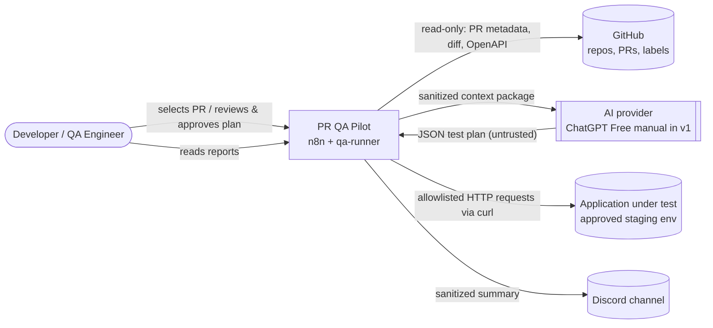
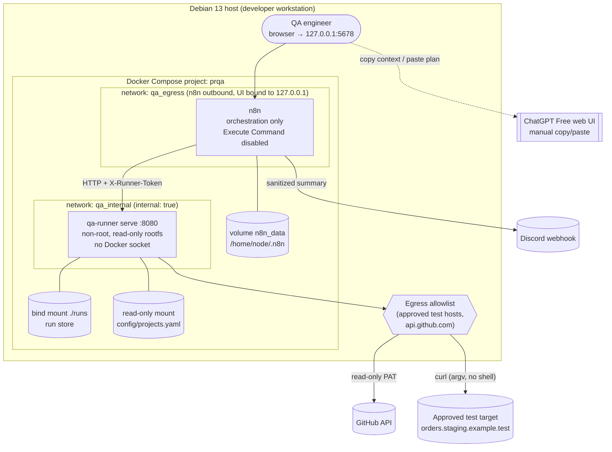
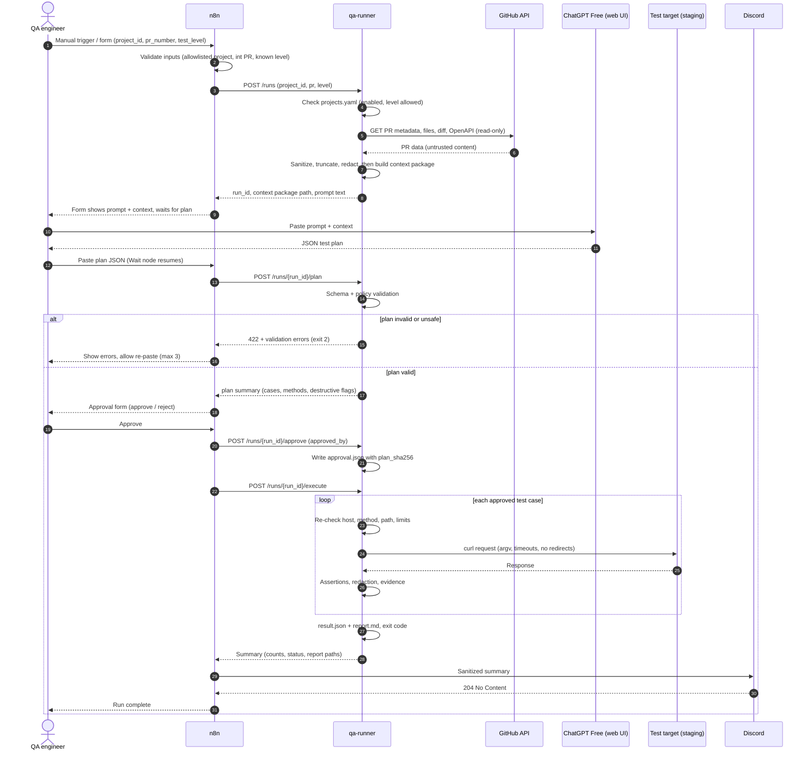
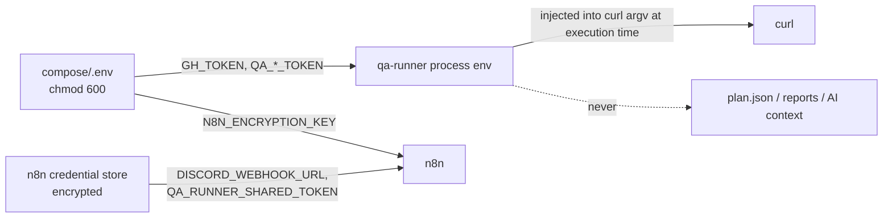
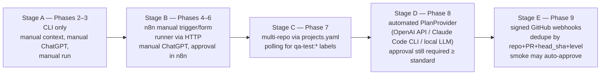

# Architecture

This document describes the system context, components, interfaces, data flow, and failure handling of PR QA Pilot, and how the system migrates from manual to automated operation.

> Status: Planned — documentation only (v0.1, 2026-10-18)

## Table of Contents

1. [System Context](#1-system-context)
2. [Component Responsibilities](#2-component-responsibilities)
3. [Architecture Diagram](#3-architecture-diagram)
4. [Sequence Diagram](#4-sequence-diagram)
5. [Data Flow](#5-data-flow)
6. [Integration Boundaries](#6-integration-boundaries)
7. [Request Transport: curl vs. Python HTTP Client](#7-request-transport-curl-vs-python-http-client)
8. [Architecture Decisions and Alternatives](#8-architecture-decisions-and-alternatives)
9. [Failure Handling](#9-failure-handling)
10. [Manual-to-Automatic Migration Strategy](#10-manual-to-automatic-migration-strategy)
11. [Related Documents](#11-related-documents)

---

## 1. System Context

PR QA Pilot tests the **deployed API** related to a GitHub Pull Request. It reads PR metadata, the diff, and API documentation. It produces a structured test plan (AI-assisted, human-reviewed), runs deterministic API tests with `curl` against an approved test environment, and publishes sanitized reports.

It **never builds or executes the PR's code** ([ADR-010](./DECISIONS.md#adr-010)). The application under test must already be deployed to an approved non-production environment, such as a staging or preview deployment, by the team's existing CI/CD.



### Actors and external systems

| Actor / System | Role | Trust level |
|---|---|---|
| QA engineer / developer | Starts runs, pastes AI output, approves plans, reads reports | Trusted (authenticated to n8n) |
| GitHub | Source of PR metadata, diffs, OpenAPI specs, and labels | Trusted service, **untrusted content** (PR text and code) |
| AI provider | Generates candidate test plans | **Untrusted output** |
| Application under test | Target of API tests | Semi-trusted; responses are untrusted data |
| Discord | Receives notifications | Outbound only; the webhook URL is a secret |

---

## 2. Component Responsibilities

### 2.1 Components

| Component | Technology | Responsibilities | Explicitly NOT responsible for |
|---|---|---|---|
| **n8n** | Self-hosted n8n in Docker ([ADR-001](./DECISIONS.md#adr-001)) | Triggers (manual, schedule, webhook), run state transitions, branching, human approval waits, retries of orchestration steps, Discord delivery, error workflow | Running shell commands, running `curl`, parsing diffs, asserting results, holding test secrets |
| **qa-runner** | Python 3.11+ package `qa_runner`, stdlib + `PyYAML` + `jsonschema` ([ADR-002](./DECISIONS.md#adr-002)) | Context building, plan schema and policy validation, approval verification, controlled `curl` execution, assertions, redaction, evidence, JSON/Markdown reports, exit codes | Deciding *what* to test (AI or human), orchestration, scheduling |
| **qa-runner serve** | Thin stdlib `http.server` wrapper | Exposes runner operations to n8n on the internal Docker network `qa_internal:8080`, authenticated by the `X-Runner-Token` header | Public exposure; arbitrary command execution |
| **curl** | System `curl`, invoked through argv ([ADR-003](./DECISIONS.md#adr-003)) | HTTP transport with strict flags, timing data through `--write-out '%{json}'` | Assertions or decisions |
| **AI planning layer** | `PlanProvider` interface ([ADR-006](./DECISIONS.md#adr-006)) | Turns a sanitized context package into a candidate JSON plan | Executing anything; its output is never trusted |
| **GitHub access** | `gh` CLI / REST API, fine-grained read-only PAT | PR metadata, changed files, diff, spec retrieval | Writing to repos (v1), running PR code |
| **Run store** | Filesystem `runs/<run_id>/` ([ADR-007](./DECISIONS.md#adr-007)) | Durable record of context, plan, approval, evidence, results, reports | Long-term analytics (out of scope for v1) |
| **Config** | `config/projects.yaml` ([ADR-011](./DECISIONS.md#adr-011)) | Per-project targets, scopes, limits, auth profiles, and notification settings | Secret values. Secret values come from env vars only |
| **Discord** | Incoming webhook | Human-visible summary | Storing evidence |

### 2.2 Where each responsibility belongs

This answers the brief's requirement to avoid forcing everything into n8n.

| Responsibility | n8n | Python runner | GitHub | AI provider | Isolated env | Rationale |
|---|:-:|:-:|:-:|:-:|:-:|---|
| Detect PR / label | **●** (poll/webhook) | | source | | | Event handling and scheduling is n8n's core strength |
| Fetch PR metadata, diff, spec | | **●** | source | | | Needs parsing, size limits, and sanitization. Keeps `GH_TOKEN` out of n8n |
| Build sanitized AI context | | **●** | | | | Deterministic, testable code; redaction rules live in one place |
| Generate test plan | | | | **●** | | Creative, non-deterministic step; output is untrusted |
| Paste / review / approve plan | **●** (Wait/Form) | records `approval.json` | | | | Human-in-the-loop UX lives in n8n; integrity check in Python |
| Schema + policy validation | | **●** | | | | Must be deterministic and unit-testable |
| Execute HTTP requests | | **●** (drives curl) | | | **●** (runner container) | Network egress restricted to approved targets ([ADR-005](./DECISIONS.md#adr-005)) |
| Assertions | | **●** | | | | Deterministic, versioned code, not AI |
| Redaction and evidence | | **●** | | | | Before anything leaves the runner |
| Reports (MD/JSON) | | **●** | | | | Single report generator for all triggers |
| Notifications | **●** | renders payload (`notify --dry-run`) | | | | n8n has native retries and credentials for webhooks |
| Run history | | **●** (files) | | | | File-based, inspectable, git/backup friendly |
| Status checks / PR comments (future) | **●** | renders text | target | | | Write access added only in a later phase, if approved |

---

## 3. Architecture Diagram

> An interactive, explorable version of this overview is in [diagrams/system-architecture.html](../diagrams/system-architecture.html).



**Key points**

- n8n and the runner are separate containers. n8n can reach the runner only over `qa_internal`; the runner has no inbound port on the host.
- Only the runner holds `GH_TOKEN` and `QA_<PROJECT>_<PROFILE>_TOKEN` values. n8n holds `DISCORD_WEBHOOK_URL` and `QA_RUNNER_SHARED_TOKEN`.
- Egress control is enforced twice: by the runner's host/IP allowlist check before every request, and at the network layer by firewall rules or an egress proxy ([SECURITY.md](./SECURITY.md)). `[Recommendation]`
- An `internal: true` Docker network has no external access. The runner therefore needs a controlled egress path, such as a second network routed through an allowlisting proxy. That design is detailed in [SECURITY.md](./SECURITY.md) and [LOCAL_SETUP.md](./LOCAL_SETUP.md). `[Verify]` Validate the chosen egress mechanism on the host's Docker version.

---

## 4. Sequence Diagram

The v1 flow uses the manual trigger and the manual ChatGPT Free provider.



---

## 5. Data Flow

Each stage has a clear input, output, and storage location. Every artifact is written under `runs/<run_id>/`. The run ID format is `YYYYMMDDTHHMMSSZ-<project_id>-pr<number>-<head_sha7>`.

| # | Stage | Input | Output artifact | Producer | Trust of output |
|---|---|---|---|---|---|
| 1 | Trigger | `project_id`, `pr_number`, `test_level` | run record in n8n execution | n8n | Validated input |
| 2 | Context build | GitHub PR data, OpenAPI spec | `context/pr-metadata.json`, `context/diff-summary.md`, `context/openapi-excerpt.yaml`, `context/prompt.md` | runner | Sanitized but **content still untrusted** |
| 3 | Plan generation | `context/prompt.md` | candidate plan JSON | AI provider / human | **Untrusted** |
| 4 | Validation | candidate plan, `projects.yaml`, `test-plan.schema.json` | `plan.json` (normalized) + validation report | runner | Validated against schema + policy |
| 5 | Approval | `plan.json` | `approval.json` (`plan_sha256`, `approved_by`, `approved_at`, `destructive_allowed`) | human via n8n, recorded by runner | Trusted decision bound to plan hash |
| 6 | Execution | `plan.json`, `approval.json`, env secrets | `evidence/TC-xxx.request.json`, `evidence/TC-xxx.response.json` (redacted), `run.log` | runner + curl | Redacted evidence |
| 7 | Reporting | evidence + results | `result.json`, `report.md` | runner | Deterministic |
| 8 | Notification | `result.json` summary | Discord message | n8n (payload rendered by runner) | Sanitized summary only |

Examples of each artifact: [pr-metadata](./examples/pr-metadata.example.json), [diff summary](./examples/diff-summary.example.md), [test plan](./examples/test-plan.example.json), [result](./examples/execution-result.example.json), [report](./examples/qa-report.example.md), [Discord message](./examples/discord-notification.example.json).

### Secret flow



Plans refer to credentials only by `auth_profile` name (for example `tenant_a_user`). The runner resolves the name to an env var at execution time and redacts the value from all outputs.

> Note: argv values can be visible to other processes in the same PID namespace (`/proc/<pid>/cmdline`). The runner container runs only the runner, which limits that exposure. Prefer passing headers via a temp `--config` file with mode 0600 or via `-H @file` where the curl version supports it. `[Recommendation]` `[Verify]` against the curl manual for curl 8.17.0.

---

## 6. Integration Boundaries

| Boundary | Interface | Direction | Auth | Validation at boundary |
|---|---|---|---|---|
| User ↔ n8n | n8n UI / Form on `127.0.0.1:5678` | in | n8n owner account | n8n input validation node (allowlisted project IDs, integer PR, known level) |
| n8n ↔ runner | HTTP JSON on `qa_internal:8080` | n8n → runner | `X-Runner-Token` shared secret | Runner re-validates every field; rejects unknown keys |
| runner ↔ GitHub | `gh api` / REST | runner → GitHub | Fine-grained PAT (Metadata, Contents, Pull requests: read) | Repo must match `projects.yaml`; `head_sha` pinned at context time |
| runner ↔ AI | Files (`context/prompt.md` → plan JSON) | via human in v1 | none (manual) | Schema + policy validation ([AI_TEST_PLAN_SPEC.md](./AI_TEST_PLAN_SPEC.md)) |
| runner ↔ test target | `curl` HTTPS/HTTP | runner → target | `auth_profile` token from env | Host allowlist, method allowlist, path scope, request budget, timeouts |
| n8n ↔ Discord | Incoming webhook POST | n8n → Discord | Webhook URL secret | Payload built from `result.json` summary only |

### Runner HTTP API (planned)

| Method & path | Maps to CLI | Purpose |
|---|---|---|
| `POST /runs` | `qa-runner context build` | Create run, fetch PR data, build context |
| `POST /runs/{run_id}/plan` | `qa-runner plan validate` | Store and validate candidate plan |
| `POST /runs/{run_id}/approve` | `qa-runner plan approve` | Record approval bound to plan hash |
| `POST /runs/{run_id}/execute` | `qa-runner run` + `qa-runner report` | Execute approved plan, produce reports |
| `GET /runs/{run_id}` | — | Status and summary |
| `GET /runs/{run_id}/notification` | `qa-runner notify --dry-run` | Rendered sanitized Discord payload |
| `GET /healthz` | — | Liveness |

The HTTP wrapper maps runner exit codes to HTTP responses: `0`/`1`/`3` → `200` with `exit_code` in the body (the run completed and the outcome is in the result), `2` → `422`, `4` → `409`, `5` → `500`.

---

## 7. Request Transport: curl vs. Python HTTP Client

The brief asks whether a Python HTTP client is necessary.

| Criterion | `curl` via `subprocess` (argv) | Python `urllib` (stdlib) | `requests` / `httpx` |
|---|---|---|---|
| Matches user's stated preference (API testing with curl) | **Yes** | No | No |
| Reproducibility: humans can replay the exact request | **Excellent**: report can include a redacted, copy-pasteable curl command | Needs translation | Needs translation |
| Timing breakdown | **Built-in** (`--write-out '%{json}'`: DNS, connect, TLS, TTFB, total) | Manual | Partial |
| Extra dependencies | None (system `curl` 8.17.0 `[Verified]`) | None | Third-party package |
| Shell-injection risk | None if `shell=False` and argv list; never string-built | None | None |
| Fine-grained control (redirects, protocols, proxy) | Flags: `--max-redirs 0`, `--proto =http,https`, `--noproxy` | Manual | Good |
| Process overhead | One process per request (acceptable at ≤200 requests/run) | Lower | Lower |
| Secret exposure | argv visible within container PID namespace; mitigated by a 0600 config file | In-process only | In-process only |

**Decision:** keep `curl` as the only request-execution mechanism ([ADR-003](./DECISIONS.md#adr-003)). Python builds the argv, captures stdout, headers and write-out JSON, and performs all assertions. No pytest. A Python HTTP client is **not necessary** for v1. If a future need appears, such as very high request volumes, it can be added behind the same `Transport` interface without changing plans or reports.

### Planned curl invocation shape

```python
argv = [
    "curl", "--silent", "--show-error",
    "--request", case.method,                 # validated against allowlist
    "--url", full_url,                         # base_url from projects.yaml + validated path
    "--max-time", str(timeout_s),
    "--connect-timeout", "5",
    "--max-redirs", "0",
    "--proto", "=http,https",
    "--noproxy", "*",                          # or route via egress proxy, see SECURITY.md
    "--dump-header", hdr_file,
    "--output", body_file,
    "--write-out", "%{json}",
    "--config", secret_cfg_file,               # 0600, holds auth header; deleted after use
]
for k, v in safe_headers.items():
    argv += ["--header", f"{k}: {v}"]
if body_file_in:
    argv += ["--data-binary", f"@{body_file_in}"]
subprocess.run(argv, shell=False, capture_output=True, timeout=timeout_s + 5, check=False)
```

This sketch is illustrative, not implemented code. Exact flag behavior must be confirmed against `man curl` on the target version. `[Verify]`

---

## 8. Architecture Decisions and Alternatives

| Decision | Chosen | Main alternatives considered | Why chosen | ADR |
|---|---|---|---|---|
| Orchestrator | Self-hosted n8n | GitHub Actions only; Python-only (cron/CLI); Temporal/Airflow | Visual flows, built-in human approval (Wait/Form), credentials store, free self-hosted; Temporal/Airflow too heavy | [ADR-001](./DECISIONS.md#adr-001) |
| Execution engine placement | Separate Python runner | Code/Execute Command nodes inside n8n | Testable, versioned, reusable from CLI/CI; avoids shell in n8n | [ADR-002](./DECISIONS.md#adr-002) |
| Transport | curl via argv | Python HTTP client | User preference, replayable evidence, timing data | [ADR-003](./DECISIONS.md#adr-003) |
| AI in v1 | Manual ChatGPT Free | Browser automation; unofficial endpoints; paid API | Free, compliant, no undocumented integrations | [ADR-004](./DECISIONS.md#adr-004) |
| Isolation | Dedicated hardened runner container | Run on host; run inside n8n container | Limits blast radius, no Docker socket, egress control | [ADR-005](./DECISIONS.md#adr-005) |
| AI extensibility | `PlanProvider` interface | Hard-code one provider | Swap providers without touching runner core | [ADR-006](./DECISIONS.md#adr-006) |
| Storage | Files under `runs/` | SQLite / Postgres | Simple, inspectable, enough for v1 | [ADR-007](./DECISIONS.md#adr-007) |
| Plan safety | Schema + policy + approval bound to hash | Trust AI output; schema only | AI output is untrusted; approval must not survive edits | [ADR-008](./DECISIONS.md#adr-008) |
| Trigger | Manual → polling → webhook | Webhook first | Webhook requires public ingress and dedupe; polling works locally | [ADR-009](./DECISIONS.md#adr-009) |
| Code execution | Never execute PR code | Build/run PR in sandbox | Removes the largest attack surface; test deployed envs only | [ADR-010](./DECISIONS.md#adr-010) |
| Multi-repo | `projects.yaml` | One workflow per repo | No workflow duplication | [ADR-011](./DECISIONS.md#adr-011) |

### Testing an application vs. executing untrusted repository code

| | Testing a deployed application (this system) | Executing repository code |
|---|---|---|
| What runs | Our runner sends HTTP requests | PR-authored code (build scripts, tests, Dockerfiles) |
| Who controls the code | Us (versioned runner) | Any PR author, including forks |
| Main risks | Over-broad requests, data damage on target, secret leakage in reports | Arbitrary code execution, secret exfiltration, supply-chain attacks, host compromise |
| Mitigations | Allowlists, budgets, approvals, redaction | Requires strong sandboxing; out of scope for this project |

PR QA Pilot stays on the left side of that table ([ADR-010](./DECISIONS.md#adr-010)).

---

## 9. Failure Handling

### 9.1 Failure classes and owners

| Failure | Detected by | Test status | `failure_class` | Retry? | Run-level effect |
|---|---|---|---|---|---|
| Assertion does not hold | runner | FAIL | `ASSERTION_FAILED` | No (deterministic). Confirmation re-run happens in a separate step | exit 1 |
| 5xx not expected by plan | runner | FAIL | `UNEXPECTED_5XX` | No | exit 1 |
| Response violates JSON schema | runner | FAIL | `SCHEMA_MISMATCH` | No | exit 1 |
| Connection refused / DNS / TLS | runner (curl exit code) | ERROR | `TRANSPORT_ERROR` | Yes: up to 2, backoff 2s/4s, **idempotent methods only** (GET, HEAD, OPTIONS) | exit 3 if no FAIL |
| curl `--max-time` exceeded | runner | ERROR | `TIMEOUT` | Same as above | exit 3 if no FAIL |
| Pre-flight health check fails | runner | BLOCKED (all) | `ENVIRONMENT_UNAVAILABLE` | Run-level retry by n8n (1×, after 60 s) | exit 3 |
| Token missing / auth setup call fails | runner | BLOCKED | `AUTH_SETUP_FAILED` | No | exit 3 |
| Destructive case not approved; host/path outside scope | runner | BLOCKED | `POLICY_BLOCKED` | No | — |
| `depends_on` case did not PASS | runner | BLOCKED | `DEPENDENCY_FAILED` | No | — |
| Bug in runner | runner | ERROR | `RUNNER_ERROR` | No | exit 5 |
| Plan invalid | runner | — (no execution) | — | Human re-paste (max 3) | exit 2 |
| Config invalid | runner | — | — | No | exit 4 |
| Runner unreachable | n8n HTTP node | — | — | n8n node retry: 3× with 5 s wait | error workflow |
| Discord delivery fails | n8n | — | — | 3× with 10 s wait; then log and mark `notification_failed` | Run result unaffected |

Non-idempotent requests (POST, PUT, PATCH, DELETE) are **never retried automatically**, because a retry could create duplicate data on the target. The runner reports them as ERROR with evidence.

### 9.2 Interrupted runs

Every runner step is idempotent with respect to its artifacts. `context build` and `plan validate` overwrite their outputs, and `run` refuses to start when `result.json` exists unless `--force-rerun` is given, which writes `result.rerun-<n>.json`. n8n stores the `run_id`, so a resumed workflow can query `GET /runs/{run_id}` and continue from the last completed stage. Recovery steps are in [OPERATIONS_RUNBOOK.md](./OPERATIONS_RUNBOOK.md).

A detailed walk-through is in [examples/failure-retry-scenario.md](./examples/failure-retry-scenario.md).

---

## 10. Manual-to-Automatic Migration Strategy

The runner core (validation, execution, assertions, reporting) does not change between stages. Only the trigger and the plan provider change.



| Stage | Trigger | Plan provider | Approval | Prerequisite gate |
|---|---|---|---|---|
| A | CLI | `manual` | `qa-runner plan approve` | Phase 2 acceptance criteria met |
| B | n8n Manual / Form | `manual` | n8n Wait/Form | MVP criteria in [PROJECT_PLAN.md](./PROJECT_PLAN.md) |
| C | n8n Schedule polling | `manual` | n8n Wait/Form | Per-project policies, read-only PAT per repo |
| D | Polling | automated provider | Required for standard, comprehensive, security | Provider evaluated in [COST_AND_ALTERNATIVES.md](./COST_AND_ALTERNATIVES.md); same validator |
| E | Webhook (signature verified) | automated provider | Auto only for `qa-test:smoke` with a valid plan; human for the rest | Duplicate-run prevention, public ingress hardening ([DEPLOYMENT.md](./DEPLOYMENT.md)) |

Rules that never change across stages:

1. AI output is always validated by the same schema and policy.
2. Only approved plans execute, and approval is bound to `plan_sha256`.
3. `security` level always requires human approval and runs against staging only.
4. PR code is never executed.

---

## 11. Related Documents

- [PROJECT_PLAN.md](./PROJECT_PLAN.md): scope, phases, success criteria
- [WORKFLOW_DESIGN.md](./WORKFLOW_DESIGN.md): n8n stages and node-by-node design
- [AI_TEST_PLAN_SPEC.md](./AI_TEST_PLAN_SPEC.md): plan schema, prompts, provider abstraction
- [SECURITY.md](./SECURITY.md): threat model and controls
- [REPORTING.md](./REPORTING.md): result and report formats
- [DEPLOYMENT.md](./DEPLOYMENT.md): deployment options
- [DECISIONS.md](./DECISIONS.md): ADR log
