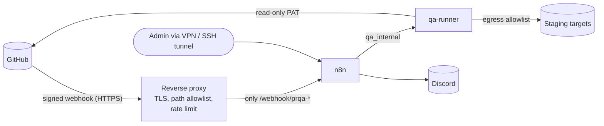

# Deployment

This document covers deployment options for PR QA Pilot, from the local development setup to a future always-on server, including GitHub integration, storage, secrets, monitoring, backups, upgrades, and rollback.

> Status: Planned — documentation only (v0.1, 2026-10-18)

## Table of Contents

1. [Local Development Architecture](#1-local-development-architecture)
2. [Future Server Deployment Options](#2-future-server-deployment-options)
3. [GitHub Integration Options](#3-github-integration-options)
4. [Persistent Storage](#4-persistent-storage)
5. [Secrets Management](#5-secrets-management)
6. [Monitoring](#6-monitoring)
7. [Backups and Restore](#7-backups-and-restore)
8. [Upgrade Procedure](#8-upgrade-procedure)
9. [Rollback Procedure](#9-rollback-procedure)
10. [Deployment Readiness Checklist](#10-deployment-readiness-checklist)

---

## 1. Local Development Architecture

Local-first is the only supported mode until Phase 10. Setup commands are in [LOCAL_SETUP.md](./LOCAL_SETUP.md).

| Item | Local value |
|---|---|
| Host | Debian 13 workstation `[Verified]`, Docker 27.5.1, Docker Compose 2.26.1 `[Verified]` |
| Compose project | `prqa`, file `compose/docker-compose.yml`, env file `compose/.env` (chmod 600) |
| Services | `n8n` (image `docker.n8n.io/n8nio/n8n:<PINNED_VERSION>`), `qa-runner` (locally built image `prqa/qa-runner:<git-sha>`) |
| Exposure | n8n on `127.0.0.1:5678` only; runner has no host port |
| Networks | `qa_egress` (n8n outbound + egress-proxy), `qa_internal` (`internal: true`, n8n ↔ runner ↔ egress-proxy), optional `qa_targets` (local API under test). The runner has no direct internet route ([SECURITY.md §7](./SECURITY.md#7-network-restrictions), canonical compose in [LOCAL_SETUP.md](./LOCAL_SETUP.md)) |
| Storage | Named volume `n8n_data`; bind mount `./runs`; read-only mount `./config` |
| Test targets | Local mock or an approved staging URL listed in `projects.yaml` |

Illustrative Compose skeleton (planned; values and hardening flags must be validated in Phase 1):

```yaml
name: prqa
services:
  n8n:
    image: docker.n8n.io/n8nio/n8n:${N8N_VERSION}        # pin an exact version
    restart: unless-stopped
    ports: ["127.0.0.1:5678:5678"]
    environment:
      - N8N_HOST=localhost
      - N8N_ENCRYPTION_KEY=${N8N_ENCRYPTION_KEY}
      - GENERIC_TIMEZONE=${GENERIC_TIMEZONE}
      - NODES_EXCLUDE=["n8n-nodes-base.executeCommand","n8n-nodes-base.localFileTrigger"]
    volumes: ["n8n_data:/home/node/.n8n"]
    networks: [qa_egress, qa_internal]
  qa-runner:
    build: ../runner
    image: prqa/qa-runner:${RUNNER_TAG}
    restart: unless-stopped
    user: "10001:10001"
    read_only: true
    tmpfs: ["/tmp:size=64m,mode=1777"]
    cap_drop: [ALL]
    security_opt: ["no-new-privileges:true"]
    environment:
      - QA_RUNNER_SHARED_TOKEN=${QA_RUNNER_SHARED_TOKEN}
      - GH_TOKEN=${GH_TOKEN}
      - QA_ACME_ORDERS_TENANT_A_TOKEN=${QA_ACME_ORDERS_TENANT_A_TOKEN}
      - QA_ACME_ORDERS_TENANT_B_TOKEN=${QA_ACME_ORDERS_TENANT_B_TOKEN}
    volumes:
      - ../runs:/runs
      - ../config/projects.yaml:/config/projects.yaml:ro
    networks: [qa_internal]            # external hosts only via egress-proxy (see LOCAL_SETUP.md)
    # NO /var/run/docker.sock, NO host paths beyond the two above
volumes:
  n8n_data:
networks:
  qa_internal:
    internal: true
  qa_egress:        # n8n + egress-proxy only; the runner is never attached
```

`[Verify]` every key against the Docker Compose specification and the n8n Docker documentation for the pinned version.

---

## 2. Future Server Deployment Options

Selecting an option is a Phase 10 decision. `[Needs approval]`

| Option | Description | Pros | Cons | Cost type |
|---|---|---|---|---|
| **A. Same Compose on a small Linux VM** (recommended first server) | Copy `compose/` to a Debian VM; add a reverse proxy with TLS for webhooks | Same artifacts as local; simple; cheap | You operate OS patching, backups, TLS | Fixed monthly VM cost `[Paid]` `[Verify]` with provider |
| B. On-prem / office server | Same as A on owned hardware | No cloud bill; close to internal staging | Uptime and physical maintenance | Hardware + power |
| C. n8n Cloud + self-hosted runner | Managed n8n calls the runner over the internet | No n8n ops | Runner must be internet-exposed (bigger attack surface); n8n Cloud is paid `[Paid]` `[Verify]` | Subscription |
| D. GitHub Actions only (no n8n) | Workflow runs the runner on label events | No server | Loses n8n approval UX; secrets live in GitHub; must avoid `pull_request_target` pitfalls | Free minutes quota / paid beyond `[Verify]` |
| Kubernetes | — | — | Unjustified complexity for this scale | Not recommended |

### Option A topology



Server hardening requirements:

- The n8n editor UI is **not** exposed publicly. Access it through VPN or an SSH tunnel (`ssh -L 5678:127.0.0.1:5678 host`).
- The reverse proxy exposes only the webhook path. Webhooks are HMAC-verified in the workflow.
- The host firewall allows inbound 443 (proxy) and 22 (SSH, key-only). Outbound from the runner is limited to approved targets and `api.github.com`.
- Unattended OS security updates are enabled, and Docker images are pinned and updated through the procedure in §8.

---

## 3. GitHub Integration Options

| Criterion | Polling (n8n Schedule → runner) | GitHub Webhooks → n8n | GitHub Actions |
|---|---|---|---|
| Works fully local (no public URL) | **Yes** | No (needs ingress or tunnel) | Runs on GitHub, so local test targets are unreachable unless self-hosted runners are used |
| Latency | Up to poll interval (5 min) | Seconds | Seconds to minutes |
| API usage | Periodic list calls per repo (within rate limits for a few repos) `[Verify]` limits | Minimal | None against our system |
| Security surface | Outbound only | Public endpoint, which needs HMAC verification and dedupe | Secrets in GitHub; risk of misusing `pull_request_target` |
| Duplicate handling | Dedupe key | Delivery ID + dedupe key | Concurrency groups |
| Fits approval UX | Yes (n8n forms) | Yes | Weak (environments/approvals exist but differ) `[Verify]` |
| Phase | 6–7 | 9 | Optional future |

**Decision:** polling first, webhooks after duplicate-run prevention exists ([ADR-009](./DECISIONS.md#adr-009)). GitHub Actions may later be used only to *add the label* or post a `workflow_dispatch`/`repository_dispatch` to our system, and never to run PR code with secrets.

**GitHub token:** fine-grained personal access token restricted to the enabled repositories, with Metadata: read, Contents: read, Pull requests: read. Set an expiry (≤ 90 days, `[Recommendation]`) and rotate it per [OPERATIONS_RUNBOOK.md](./OPERATIONS_RUNBOOK.md). For multiple repositories or teams, a GitHub App with the same read-only permissions is the better long-term option `[Recommendation]` `[Verify]` installation flow in GitHub docs. Write permissions, for example to post PR comments or status checks, are a later, separately approved change. `[Needs approval]`

---

## 4. Persistent Storage

| Data | Location | Persistence | Backup | Retention |
|---|---|---|---|---|
| n8n database, workflows, credentials (encrypted), waiting executions | Volume `n8n_data` → `/home/node/.n8n` | Survives `docker compose down` (not `down -v`) | Daily | Executions pruned per n8n settings |
| n8n encryption key | `compose/.env` (`N8N_ENCRYPTION_KEY`) | File | Separately, offline/password manager | Forever |
| Run artifacts | `./runs/<run_id>/` | Host filesystem | Daily | 90 days by default, see [REPORTING.md](./REPORTING.md) |
| Project config | `./config/projects.yaml` | Git (example) + local copy | With repo | — |
| Workflow exports | `./n8n/workflows/*.json` | Git | With repo | — |

The default SQLite database in n8n is sufficient for local and single-server use. PostgreSQL is only justified with queue mode or multiple n8n instances, which are out of scope ([ADR-007](./DECISIONS.md#adr-007) covers the runner's file store). `[Verify]` n8n's current recommendations for production databases.

---

## 5. Secrets Management

| Secret | Holder | Storage (local / server) | Rotation |
|---|---|---|---|
| `N8N_ENCRYPTION_KEY` | n8n | `compose/.env` (600) / same, plus offline backup | Only with planned re-encryption `[Verify]` |
| `QA_RUNNER_SHARED_TOKEN` | n8n credential + runner env | `.env` + n8n credential | 90 days, or immediately on suspicion |
| `GH_TOKEN` | Runner only | `.env` | Before expiry (≤ 90 days) |
| `QA_<PROJECT>_<PROFILE>_TOKEN` | Runner only | `.env` | Per test-account policy |
| `DISCORD_WEBHOOK_URL` | n8n credential | n8n credential store | On leak: delete the webhook in Discord, create a new one |
| GitHub webhook secret (Phase 9) | n8n | n8n credential | 180 days |

Rules: never commit `.env`; keep `compose/.env.example` with placeholders only; never pass secrets through plans, AI context, reports, or Discord. On a server, a dedicated secrets manager (for example the cloud provider's) can replace `.env` later. That is optional and justified only when there are multiple operators. `[Recommendation]`

---

## 6. Monitoring

The scale is small, so monitoring stays lightweight with no Prometheus stack in v1 `[Recommendation]`:

| Signal | Mechanism | Alert |
|---|---|---|
| Containers up | `docker compose ps`; `restart: unless-stopped`; runner `GET /healthz` checked by an n8n Schedule workflow every 15 min | Discord alert on 2 consecutive failures |
| Workflow failures | `prqa-error-handler` (Error Trigger) | Sanitized Discord alert |
| Run outcomes | `result.json` summary in Discord | Per run |
| Disk usage of `runs/` and `n8n_data` | Daily host cron: `du -sh` + threshold | Discord alert at 80% of allocated space |
| Token expiry | Calendar reminder + runner pre-flight GitHub check (401 → `AUTH_SETUP_FAILED`) | Discord |
| Backup success | Backup script exit code → Discord | On failure |

---

## 7. Backups and Restore

```bash
# Planned backup script outline (run from repo root, n8n stopped for a consistent copy)
docker compose -f compose/docker-compose.yml stop n8n
docker run --rm -v prqa_n8n_data:/data -v "$PWD/backups":/backup debian:13-slim \
  tar czf /backup/n8n_data-$(date -u +%Y%m%dT%H%M%SZ).tgz -C /data .
docker compose -f compose/docker-compose.yml start n8n
tar czf backups/runs-$(date -u +%Y%m%dT%H%M%SZ).tgz runs/
```

- The volume name `prqa_n8n_data` assumes Compose project `prqa`. Confirm with `docker volume ls`. `[Verify]`
- Back up `N8N_ENCRYPTION_KEY` separately. A restore without it loses all credentials.
- **Restore test (Phase 10 acceptance):** restore into a fresh Compose project on a different port, start it, and verify that workflows, credentials, and one historical run report are readable.
- Keep 7 daily and 4 weekly backups. Encrypt them if stored off-host (for example `gpg --symmetric`). `[Recommendation]`

---

## 8. Upgrade Procedure

| Step | Action | Check |
|---|---|---|
| 1 | Read the n8n release notes for breaking changes (node removals, env var changes) | Notes reviewed `[Verify]` each upgrade |
| 2 | Back up (§7) | Backup files exist and are non-empty |
| 3 | Export workflows (`n8n export:workflow`, see [WORKFLOW_DESIGN.md §13](./WORKFLOW_DESIGN.md#13-exporting-and-version-controlling-workflows)) | Diff is clean vs. git |
| 4 | Change `N8N_VERSION` / `RUNNER_TAG` in `.env` | One component at a time |
| 5 | `docker compose pull && docker compose up -d` | `docker compose ps` healthy |
| 6 | Smoke: runner `/healthz`; run the manual workflow against the local mock target with the sample plan | Report generated; Discord test message |
| 7 | Confirm Execute Command is still unavailable in the node picker | Not listed |
| 8 | Record the version change in `CHANGELOG` / ops log | — |

The runner is upgraded by building a new image tag from a git commit. The old tag is kept for rollback.

---

## 9. Rollback Procedure

1. Set `N8N_VERSION` / `RUNNER_TAG` back to the previous values in `.env`.
2. `docker compose up -d`.
3. If the n8n database was migrated by the newer version and the old version cannot read it, stop n8n, restore `n8n_data` from the pre-upgrade backup, and start again. `[Verify]` n8n database downgrade behavior. Assume downgrades require a restore.
4. Re-import workflows from git if needed.
5. Re-run the step-6 smoke from §8.
6. Write a short incident note ([OPERATIONS_RUNBOOK.md](./OPERATIONS_RUNBOOK.md)).

---

## 10. Deployment Readiness Checklist

- [ ] All MVP criteria in [PROJECT_PLAN.md](./PROJECT_PLAN.md) met and evidenced
- [ ] Images pinned to exact versions; no `latest`
- [ ] n8n UI bound to localhost / VPN only; owner account with a strong password
- [ ] Execute Command and Local File Trigger excluded (`NODES_EXCLUDE`) and verified absent
- [ ] Runner: non-root, read-only rootfs, `cap_drop: ALL`, `no-new-privileges`, no Docker socket
- [ ] Runner egress restricted to approved hosts; metadata endpoint (`169.254.169.254`) unreachable (tested)
- [ ] `.env` mode 600, not in git; `.env.example` has placeholders only
- [ ] GitHub token fine-grained, read-only, repo-scoped, expiry set
- [ ] Webhook (if enabled): HMAC verified, delivery-ID dedupe, label + repo allowlist, reverse proxy exposes the webhook path only
- [ ] Workflow exports committed and scanned for secrets
- [ ] Backups automated; restore test performed and documented
- [ ] Monitoring alerts tested (health, error workflow, disk, backup)
- [ ] Security checklist in [SECURITY.md](./SECURITY.md) completed
- [ ] Runbook reviewed by a second person ([OPERATIONS_RUNBOOK.md](./OPERATIONS_RUNBOOK.md))
- [ ] Production targets absent from every `projects.yaml` entry (`allowed_environment` ≠ production)
