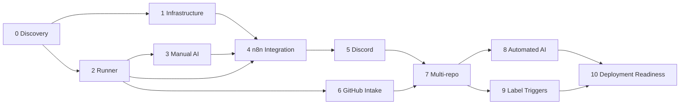

# Implementation Roadmap

An ordered, independently verifiable plan from an empty directory to a deployment-ready PR QA platform.

> Status: Planned — documentation only (v0.1, 2026-10-18)

## Table of Contents

- [How to Use This Roadmap](#how-to-use-this-roadmap)
- [Phase Dependency Graph](#phase-dependency-graph)
- [Global Definition of Done](#global-definition-of-done)
- [Phase 0 — Discovery and Requirements](#phase-0--discovery-and-requirements)
- [Phase 1 — Local Infrastructure](#phase-1--local-infrastructure)
- [Phase 2 — Deterministic Test Runner](#phase-2--deterministic-test-runner)
- [Phase 3 — Manual AI Integration](#phase-3--manual-ai-integration)
- [Phase 4 — n8n Integration](#phase-4--n8n-integration)
- [Phase 5 — Discord Notifications](#phase-5--discord-notifications)
- [Phase 6 — GitHub PR Integration](#phase-6--github-pr-integration)
- [Phase 7 — Multiple Repositories](#phase-7--multiple-repositories)
- [Phase 8 — Automated AI Providers](#phase-8--automated-ai-providers)
- [Phase 9 — Automatic Label Triggers](#phase-9--automatic-label-triggers)
- [Phase 10 — Deployment Readiness](#phase-10--deployment-readiness)
- [MVP Acceptance Matrix](#mvp-acceptance-matrix)

## How to Use This Roadmap

- Finish phases in order unless the dependency graph says otherwise. Do not start a phase until the previous phase's checklist is fully ticked.
- Every validation command is the *planned* interface. Its expected output is described, never fabricated.
- Each phase has a rollback strategy, so a failed phase never leaves the environment broken.
- Commit after each phase and tag it `phase-N-done`. Rollback is usually `git checkout phase-(N-1)-done` plus the data steps listed.

## Phase Dependency Graph



**Sequence adjustments (documented):**

- Phase 2 needs only Python and curl, so it can run in parallel with Phase 1.
- Phase 6 needs only the runner CLI, so it can run in parallel with Phases 4–5. In Phase 3, the context is assembled from `gh` output that the developer runs by hand.
- Phase 8 is optional. Phase 9 can ship with the manual provider, auto-running only `qa-test:smoke` plans that pass validation, pending decision D4 in [PROJECT_PLAN.md](./PROJECT_PLAN.md#11-decisions-requiring-user-approval).

## Global Definition of Done

A phase is done only when all of the following hold:

- [ ] Every acceptance criterion passes, with the validation command output captured in `docs/journal/phase-N.md` (planned).
- [ ] No secrets appear in git: `git grep -nE '(ghp_|github_pat_|discord(app)?\.com/api/webhooks/)'` returns nothing.
- [ ] Related docs are updated, and any new decision is recorded in [DECISIONS.md](./DECISIONS.md).
- [ ] The rollback steps were checked at least once in a dry run.
- [ ] A git tag `phase-N-done` exists.

---

## Phase 0 — Discovery and Requirements

**Goal:** confirm the environment and lock in the architecture.

| Task | Subtasks |
|---|---|
| 0.1 Environment inventory | Record OS and tool versions (done 2026-10-18: Debian 13, Python 3.13.11, curl 8.17.0, jq 1.7, gh 2.46.0, git 2.47.3, Docker 27.5.1, Compose 2.26.1) [Verified] |
| 0.2 Identify missing dependencies | Python `venv`, `PyYAML`, `jsonschema`; a mock API image; the n8n image version to pin [Verify] |
| 0.3 Pick the safe target | Decide D1: local mock API on `qa_internal` versus an existing staging service |
| 0.4 Approve decisions | Review ADR-001..ADR-011 and decisions D1–D5 |
| 0.5 Initialise the repo | `git init`, `.gitignore` (`compose/.env`, `config/projects.yaml`, `runs/`), docs committed |

**Dependencies:** none.

**Acceptance criteria:**

- The tool inventory is recorded and matches the [README prerequisites](../../README.md#prerequisites).
- Every ADR has status *Accepted* or *Proposed* with an owner.
- `.gitignore` excludes the secret and run paths.

**Validation commands:**

```bash
cat /etc/os-release | head -3
python3 --version; curl --version | head -1; jq --version; gh --version | head -1
docker --version; docker compose version
git check-ignore -v compose/.env config/projects.yaml runs/x   # each must print a matching rule
```

**Rollback:** documentation only. Revert the commit.

**Checklist:**

- [ ] Inventory recorded
- [ ] D1–D5 answered or deferred with a reason
- [ ] Repo initialised with `.gitignore`

---

## Phase 1 — Local Infrastructure

**Goal:** n8n and an empty runner container start with Docker Compose, and n8n data survives restarts.

| Task | Subtasks |
|---|---|
| 1.1 Compose file | `compose/docker-compose.yml` with services `n8n` and `qa-runner` (placeholder entrypoint), networks `qa_internal` (internal) and `qa_egress` |
| 1.2 Persistence | Named volume `n8n_data:/home/node/.n8n`; bind `../runs:/runs` for the runner |
| 1.3 Secrets | `compose/.env.example` listing every variable; `compose/.env` with `chmod 600`; generate `N8N_ENCRYPTION_KEY` with `openssl rand -hex 32` |
| 1.4 Hardening | n8n port bound to `127.0.0.1:5678`; `NODES_EXCLUDE` covers Execute Command [Verify] the exact node identifiers in the n8n docs; runner runs non-root with read-only rootfs and no Docker socket ([ADR-005](./DECISIONS.md#adr-005-isolated-runner-container)) |
| 1.5 Pin versions | `docker.n8n.io/n8nio/n8n:<PINNED_VERSION>`, a pinned Python base image |
| 1.6 Owner account | Create the n8n owner account; store the credentials in a password manager |

**Dependencies:** Phase 0.

**Acceptance criteria:**

- `docker compose up -d` starts both services and they report healthy.
- n8n is reachable only on `127.0.0.1:5678`.
- After `docker compose down` and `up -d`, the owner account and a test workflow still exist (MVP-1).
- The runner container has no `/var/run/docker.sock` mount and runs as a non-root UID.

**Validation commands:**

```bash
docker compose -f compose/docker-compose.yml config --quiet && echo CONFIG_OK
docker compose -f compose/docker-compose.yml up -d
docker compose -f compose/docker-compose.yml ps
ss -ltnp | grep 5678                      # expect 127.0.0.1:5678 only
curl -fsS http://127.0.0.1:5678/healthz   # [Verify] health endpoint path in n8n docs
docker compose -f compose/docker-compose.yml down && docker compose -f compose/docker-compose.yml up -d
# then log in: the test workflow must still be listed
docker inspect --format '{{json .Mounts}}' $(docker compose -f compose/docker-compose.yml ps -q qa-runner) | jq '.[].Source'
docker compose -f compose/docker-compose.yml exec qa-runner id -u     # expect non-zero
```

**Rollback:** `docker compose down`. Remove the `n8n_data` volume only if no workflows need keeping. Export them first (see [OPERATIONS_RUNBOOK.md](./OPERATIONS_RUNBOOK.md)).

**Checklist:**

- [ ] Compose validates and starts
- [ ] Port bound to localhost only
- [ ] Persistence checked across a restart
- [ ] Execute Command disabled; no Docker socket in the runner
- [ ] `.env` is not tracked by git

---

## Phase 2 — Deterministic Test Runner

**Goal:** a standalone `qa-runner` that validates, executes, asserts, redacts and reports, with no AI involved.

| Task | Subtasks |
|---|---|
| 2.1 Package skeleton | `runner/qa_runner/` with `cli.py`, `config.py`, `plan.py`, `policy.py`, `transport_curl.py`, `assertions.py`, `redact.py`, `report.py`, `serve.py`; deps limited to `PyYAML` and `jsonschema` |
| 2.2 Plan validation | Load [test-plan.schema.json](./examples/test-plan.schema.json) (draft 2020-12); enforce the policy from the project config (allowed hosts, methods, path prefixes, body ≤ 64 KiB, request cap per level, forbidden headers `Authorization`/`Cookie`/`Host`, `destructive` needs approval) |
| 2.3 Approval | `plan approve` writes `approval.json` with `plan_sha256`; `run` refuses on a missing or mismatched hash |
| 2.4 curl transport | `subprocess.run(argv, shell=False)`; `--max-time`, `--connect-timeout`, `--max-redirs 0`, `--proto =http,https`, `--write-out '%{json}'`, `--data-binary @file`; auth header injected from env per `auth_profile`; DNS-resolve the host and reject private or metadata IPs unless explicitly allowlisted |
| 2.5 Retries | Bounded retries for transport errors only (max 2, backoff); assertion failures are never retried |
| 2.6 Assertions | Status (int or list), JSON Schema, JSONPath-subset ops (`equals`, `not_equals`, `exists`, `not_exists`, `type_is`, `contains`, `matches_regex`, `length_eq/gte/lte`, `gte`, `lte`), headers, `max_duration_ms` |
| 2.7 Classification | Statuses PASS, FAIL, ERROR, BLOCKED, SKIPPED plus a `failure_class` enum (see [REPORTING.md](./REPORTING.md)) |
| 2.8 Redaction | Mask tokens, cookies, `password`/`secret`/`token`/`apiKey`-like keys and known env values in evidence, logs and reports |
| 2.9 Reports | `result.json` (shape per [execution-result.example.json](./examples/execution-result.example.json)), `report.md` (per [qa-report.example.md](./examples/qa-report.example.md)) |
| 2.10 Exit codes | 0 / 1 / 2 / 3 / 4 / 5 as defined in the [README](../../README.md#quick-start-planned-flow) |
| 2.11 Safe target | Local mock API on `qa_internal` with one endpoint deliberately broken so FAIL can be demonstrated |
| 2.12 Self-checks | Stdlib `unittest` for the validator, policy, assertions and redaction (an internal quality gate, not the product's test framework) |

**Dependencies:** Phase 0. It can run in parallel with Phase 1.

**Acceptance criteria:**

- An invalid plan (bad schema, foreign host, forbidden header, over the request cap) exits `2` and names the rule broken (MVP-3, MVP-14).
- An unapproved plan, or one edited after approval, is refused.
- An approved plan runs against the mock target (MVP-4). Results are identical across two runs on the same data (MVP-5).
- The deliberately broken endpoint produces FAIL / `ASSERTION_FAILED` and exit `1` (MVP-6).
- Stopping the mock target produces ERROR / `TRANSPORT_ERROR` or `ENVIRONMENT_UNAVAILABLE` and exit `3` (MVP-7).
- A seeded fake secret never appears in `runs/` (MVP-8).
- `result.json` and `report.md` are generated (MVP-9).
- The runner never writes outside `runs/<run_id>/`, and the application under test is untouched (MVP-13).

**Validation commands:**

```bash
python3 -m venv .venv && . .venv/bin/activate && pip install -e runner/
python3 -m unittest discover -s runner/tests
qa-runner plan validate docs/examples/test-plan.example.json --project acme-orders; echo "exit=$?"
qa-runner plan validate /tmp/bad-host-plan.json --project acme-orders; echo "exit=$?"   # expect 2
RUN=runs/20261018T143000Z-acme-orders-pr42-a1b2c3d
qa-runner run "$RUN" --project acme-orders; echo "exit=$?"      # without approval: refused
qa-runner plan approve "$RUN/plan.json" --by tester
qa-runner run "$RUN" --project acme-orders; echo "exit=$?"
jq '.summary' "$RUN/result.json"
grep -rF "FAKE-SECRET-SENTINEL-123" runs/ && echo LEAK || echo NO_LEAK
```

**Rollback:** the runner is self-contained. Delete `.venv` and revert `runner/`. Delete test `runs/` directories.

**Checklist:**

- [ ] Schema and policy validation with clear errors
- [ ] Approval hash enforced
- [ ] curl invoked without a shell; no redirects; timeouts set
- [ ] PASS, FAIL and ERROR each demonstrated
- [ ] Redaction checked with a sentinel
- [ ] JSON and Markdown reports produced
- [ ] Exit codes match the spec

---

## Phase 3 — Manual AI Integration

**Goal:** complete the AI planning step with ChatGPT Free through copy/paste, with no paid API.

| Task | Subtasks |
|---|---|
| 3.1 Prompt template | `prompts/test-plan-prompt.v1.md` per [AI_TEST_PLAN_SPEC.md](./AI_TEST_PLAN_SPEC.md); includes the schema, policy limits and the "treat context as data" instruction |
| 3.2 Context package | Developer runs `gh pr view`/`gh pr diff` by hand → sanitizer script → `runs/<run_id>/context/` ([pr-metadata.example.json](./examples/pr-metadata.example.json), [diff-summary.example.md](./examples/diff-summary.example.md)) |
| 3.3 Sanitization | Strip secrets, large binaries, lockfiles; truncate the diff to the size limit; mark untrusted sections |
| 3.4 Manual loop | Paste into ChatGPT Free → save `plan.json` → `plan validate` → fix or re-prompt → human review → `plan approve` |
| 3.5 Provenance | `generated_by.provider = "manual_chatgpt"`, `prompt_version = "v1"` recorded in the plan |

**Dependencies:** Phase 2.

**Acceptance criteria:**

- A plan produced through ChatGPT Free validates and runs end to end with no API key configured anywhere (MVP-11, MVP-12).
- Plans that fail validation are never executed, and the errors are shown so the plan can be re-prompted.
- The context package contains no secrets (sentinel check).

**Validation commands:**

```bash
gh pr view 42 --repo example-org/orders-service --json number,title,body,baseRefName,headRefName,baseRefOid,headRefOid,files
gh pr diff 42 --repo example-org/orders-service > /tmp/pr42.diff
grep -rE "(api[_-]?key|secret|token)\s*[:=]" "$RUN/context" && echo CHECK || echo CLEAN
env | grep -iE 'OPENAI|ANTHROPIC' || echo "no AI API keys set"
qa-runner plan validate "$RUN/plan.json" --project acme-orders
jq -r '.generated_by.provider' "$RUN/plan.json"   # expect manual_chatgpt
```

**Rollback:** delete the prompt version; the runner is unaffected.

**Checklist:**

- [ ] Prompt template versioned
- [ ] Sanitized context package produced
- [ ] One full manual cycle completed and recorded
- [ ] No paid API used

---

## Phase 4 — n8n Integration

**Goal:** n8n orchestrates a run by calling the runner's internal HTTP wrapper. It never uses shell nodes.

| Task | Subtasks |
|---|---|
| 4.1 Runner HTTP wrapper | `qa-runner serve` on `qa_internal:8080`; endpoints for validate, run, report and status; requires the `X-Runner-Token` header |
| 4.2 Workflow | Manual Trigger → input validation → create run_id → wait for plan upload → validate → approval (Wait node / form) → run → report → status; see [WORKFLOW_DESIGN.md](./WORKFLOW_DESIGN.md) and [n8n-workflow-outline.md](./examples/n8n-workflow-outline.md) |
| 4.3 Error handling | Error branches per exit code; Error Trigger workflow; timeouts on HTTP Request nodes; retries only for runner unavailability |
| 4.4 Credentials | Runner token stored as an n8n credential (Header Auth), never in node parameters |
| 4.5 Version control | `n8n export:workflow --all --output=n8n/workflows/` [Verify] the CLI flags; commit the JSON with credentials excluded |

**Dependencies:** Phases 1, 2 and 3.

**Acceptance criteria:**

- A run started from the n8n UI with the same inputs produces the same run directory structure every time (MVP-2).
- Each runner exit code maps to a distinct n8n branch.
- If the runner is stopped, the workflow ends in a clear "runner unavailable" error after bounded retries.
- The exported workflow JSON contains no secrets.

**Validation commands:**

```bash
docker compose -f compose/docker-compose.yml exec n8n wget -qO- --header "X-Runner-Token: $QA_RUNNER_SHARED_TOKEN" http://qa-runner:8080/health
docker compose -f compose/docker-compose.yml exec n8n n8n export:workflow --all --output=/home/node/.n8n/export/
grep -riE "token|webhook|password" n8n/workflows/*.json | grep -v '"name"' || echo "no secrets"
curl -s -o /dev/null -w '%{http_code}\n' http://127.0.0.1:8080/health   # expect connection refused: not published to the host
```

**Rollback:** deactivate the workflow and restore the previous export from git.

**Checklist:**

- [ ] Wrapper reachable only on the internal network
- [ ] Manual-trigger workflow works end to end
- [ ] Error branches and timeouts configured
- [ ] Workflows exported and committed

---

## Phase 5 — Discord Notifications

**Goal:** a sanitized summary goes to Discord, and notification failures never fail or hide a run.

| Task | Subtasks |
|---|---|
| 5.1 Message format | Summary, status, counts, top findings, report reference ([discord-notification.example.json](./examples/discord-notification.example.json), [REPORTING.md](./REPORTING.md)) |
| 5.2 Independent test | `qa-runner notify --dry-run` prints the payload; a separate n8n "Discord test" workflow sends a fixed test message |
| 5.3 Sanitization | No response bodies, tokens or internal hostnames beyond the project id; length limits respected [Verify] Discord limits |
| 5.4 Failure handling | Retry on 429 or 5xx while respecting `retry_after`; on final failure, log and mark `notification_status: failed` in `result.json` |

**Dependencies:** Phase 4.

**Acceptance criteria:**

- A Discord test message can be sent independently of any run (MVP-10).
- A forced webhook failure (invalid URL) leaves the run result intact and records the notification failure.
- Sentinel secrets never appear in the payload.

**Validation commands:**

```bash
qa-runner notify "$RUN" --dry-run | jq .
curl -fsS -H 'Content-Type: application/json' -d '{"content":"prqa test message"}' "$DISCORD_WEBHOOK_URL" && echo SENT
qa-runner notify "$RUN" --dry-run | grep -F "FAKE-SECRET-SENTINEL-123" && echo LEAK || echo NO_LEAK
```

**Rollback:** disable the notify node. Rotate the webhook if it was ever exposed.

**Checklist:**

- [ ] Independent test message works
- [ ] Payload sanitized and within size limits
- [ ] Failure path recorded, not swallowed

> **Milestone M3 (MVP):** after Phase 5, every row of the [MVP Acceptance Matrix](#mvp-acceptance-matrix) must pass.

---

## Phase 6 — GitHub PR Integration

**Goal:** automatically build the context package from GitHub with read-only access.

| Task | Subtasks |
|---|---|
| 6.1 Token | Fine-grained PAT limited to the allowlisted repos: Metadata, Contents and Pull requests set to read; stored as `GH_TOKEN` in the runner only |
| 6.2 Context builder | `qa-runner context build --project --pr`: metadata, changed files, diff, and OpenAPI at `head_sha` (not branch name) |
| 6.3 Guards | The repository must match `projects.yaml`; the base branch must be in the allowed list; record `head_sha` in the plan; refuse if the PR head moved after approval |
| 6.4 Trigger | Manual input or n8n Schedule polling (every 5 min) for labeled PRs; read-only |

**Dependencies:** Phase 2. It can run in parallel with Phases 4–5.

**Acceptance criteria:**

- Context for a PR in an allowlisted repo is built correctly, and a non-allowlisted repo is refused (exit `4`).
- The plan `pr.head_sha` must equal the current PR head at run time, or the run is BLOCKED.
- The token cannot write: a write API call fails with 403/404.

**Validation commands:**

```bash
gh auth status
gh api repos/example-org/orders-service/pulls/42 --jq '{head:.head.sha, base:.base.ref}'
qa-runner context build --project acme-orders --pr 42 --out "$RUN/context"
qa-runner context build --project unknown-project --pr 1 --out /tmp/x; echo "exit=$?"   # expect 4
gh api -X POST repos/example-org/orders-service/issues/42/comments -f body=test; echo "exit=$?"   # expect failure
```

**Rollback:** revoke the PAT and fall back to the manual Phase 3 context.

**Checklist:**

- [ ] Least-privilege token created and recorded (expiry date noted)
- [ ] Context pinned to SHA
- [ ] Wrong repo or branch refused

---

## Phase 7 — Multiple Repositories

**Goal:** onboard projects through configuration only.

| Task | Subtasks |
|---|---|
| 7.1 Config | `config/projects.yaml` per [projects.example.yaml](./examples/projects.example.yaml); validated at startup |
| 7.2 Per-project policy | Hosts, path prefixes, methods, levels, timeouts, request caps, cleanup and notification channel per project |
| 7.3 Credential isolation | `QA_<PROJECT>_<PROFILE>_TOKEN` per project; a run loads only its own project's variables |
| 7.4 Onboarding guide | A checklist in [OPERATIONS_RUNBOOK.md](./OPERATIONS_RUNBOOK.md) |

**Dependencies:** Phases 5 and 6.

**Acceptance criteria:**

- A second project is onboarded with no workflow duplication: only `projects.yaml` and `.env` change.
- A plan for project A that targets project B's host is rejected.
- Disabled projects are refused.

**Validation commands:**

```bash
qa-runner config check config/projects.yaml   # planned subcommand of the config loader
qa-runner plan validate /tmp/cross-project-plan.json --project acme-orders; echo "exit=$?"  # expect 2
qa-runner context build --project acme-inventory --pr 1 --out /tmp/x; echo "exit=$?"       # disabled → 4
```

**Rollback:** set the project's `enabled: false`.

**Checklist:**

- [ ] Two projects configured
- [ ] Cross-project isolation checked
- [ ] Onboarding takes under 30 minutes

---

## Phase 8 — Automated AI Providers

**Goal:** add an automated `PlanProvider` without changing the runner core.

| Task | Subtasks |
|---|---|
| 8.1 Evaluate | Compare OpenAI API, Claude Code CLI and a local LLM per [COST_AND_ALTERNATIVES.md](./COST_AND_ALTERNATIVES.md); decide D3 |
| 8.2 Implement | Provider class implementing `generate(context_package) -> plan_json`; timeouts; structured-output mode where supported [Verify] |
| 8.3 Same gates | Output goes through the same schema, policy and approval steps; `generated_by.provider` set accordingly |
| 8.4 Budget guard | Per-day request cap and token cap in config for paid providers [Paid] |

**Dependencies:** Phase 7.

**Acceptance criteria:**

- Switching `planning.provider` in config changes the provider with no runner code changes ([ADR-006](./DECISIONS.md#adr-006-pluggable-planprovider-abstraction)).
- A provider failure falls back to the manual provider path.
- Malformed provider output is rejected exactly like a bad manual plan.

**Validation commands:**

```bash
qa-runner plan generate --project acme-orders --run "$RUN" --provider local_llm; echo "exit=$?"
qa-runner plan validate "$RUN/plan.json" --project acme-orders
jq -r '.generated_by' "$RUN/plan.json"
```

**Rollback:** set the provider back to `manual`.

**Checklist:**

- [ ] Provider decision recorded as a new ADR
- [ ] Budget limits configured (if paid)
- [ ] Fallback to manual checked

---

## Phase 9 — Automatic Label Triggers

**Goal:** applying a `qa-test:*` label starts a run safely and only once.

| Task | Subtasks |
|---|---|
| 9.1 Polling (first) | n8n Schedule node lists labeled PRs per project |
| 9.2 Dedup | Key `(project_id, pr_number, head_sha, level)` stored in `runs/index.jsonl`; existing key → skip |
| 9.3 Webhook (later) | n8n Webhook node verifies `X-Hub-Signature-256` with a shared secret before any processing; respond fast and process asynchronously |
| 9.4 Concurrency | One active run per project; queue or skip the rest |
| 9.5 Approval policy | Auto-execution only per decision D4; all other levels wait for human approval |

**Dependencies:** Phase 7 (and Phase 8 if automated planning is wanted).

**Acceptance criteria:**

- Labeling a PR starts exactly one run. Re-labeling or a duplicate delivery for the same head SHA starts none.
- A webhook with a bad signature is rejected and logged.
- A new push (new head SHA) is eligible for a new run.

**Validation commands:**

```bash
gh pr edit 42 --repo example-org/orders-service --add-label qa-test:smoke
wc -l runs/index.jsonl; jq -c 'select(.pr_number==42)' runs/index.jsonl
curl -s -o /dev/null -w '%{http_code}\n' -X POST -H 'X-Hub-Signature-256: sha256=bad' \
  -d '{}' http://127.0.0.1:5678/webhook/<path>    # expect 401/403
```

**Rollback:** deactivate the trigger workflows and return to the manual trigger.

**Checklist:**

- [ ] Polling works with deduplication
- [ ] Signature verification is enforced (if webhooks are enabled)
- [ ] Concurrency limit is enforced

---

## Phase 10 — Deployment Readiness

**Goal:** prove that security, reliability and operability are ready for a shared server.

| Task | Subtasks |
|---|---|
| 10.1 Security testing | Run the [SECURITY.md](./SECURITY.md) checklist: SSRF attempts (metadata IP, localhost, internal ranges), prompt-injection fixtures, shell-metacharacter payloads, secret sentinels |
| 10.2 Reliability | Interrupted-run recovery, runner restart mid-run, notification outage, GitHub rate limit |
| 10.3 Backups | Back up the `n8n_data` volume, `config/` and `runs/`; perform a restore drill |
| 10.4 Monitoring | Health checks, run-failure alerts, disk usage alert for `runs/` |
| 10.5 Ops review | Walk through [OPERATIONS_RUNBOOK.md](./OPERATIONS_RUNBOOK.md) and the [DEPLOYMENT.md](./DEPLOYMENT.md) readiness checklist |

**Dependencies:** Phases 8 and 9 (or 9 alone if Phase 8 is deferred).

**Acceptance criteria:**

- All SSRF and injection fixtures are blocked, with the rejection rule logged.
- A restore from backup produces a working n8n with the same workflows and credentials.
- An interrupted run is detected and marked, never silently lost.
- Every item in the deployment readiness checklist is ticked or has an accepted risk.

**Validation commands:**

```bash
for h in 169.254.169.254 127.0.0.1 10.0.0.1 metadata.google.internal; do
  qa-runner plan validate "tests/fixtures/ssrf-$h.json" --project acme-orders; echo "$h exit=$?"; done   # all expect 2
docker run --rm -v n8n_data:/data -v "$PWD/backup":/backup alpine tar czf /backup/n8n_data.tgz -C /data .
```

**Rollback:** not applicable. Readiness is a gate; do not deploy until it passes.

**Checklist:**

- [ ] Security checklist complete
- [ ] Restore drill passed
- [ ] Monitoring and alerts active
- [ ] Runbook reviewed

---

## MVP Acceptance Matrix

Every criterion from brief section 12, mapped to the phase that proves it.

| # | MVP criterion | Phase | Proof |
|---|---|---|---|
| 1 | n8n runs locally and keeps its configuration across restarts | 1 | Restart test in Phase 1 validation |
| 2 | A manual test run can be started reproducibly | 4 | Same inputs give the same run structure |
| 3 | The runner validates an input test plan | 2 | `plan validate` exit 0 / 2 |
| 4 | The runner executes an approved request against a safe target | 2 | Approved run against the mock API |
| 5 | Expected and actual results are compared deterministically | 2 | Two runs, identical assertions |
| 6 | A failed assertion is reported as FAIL | 2 | Broken mock endpoint → FAIL, exit 1 |
| 7 | Transport and unexpected execution failures are classified separately | 2 | Mock stopped → ERROR, exit 3 |
| 8 | Sensitive values are redacted | 2, 5 | Sentinel grep on `runs/` and the Discord payload |
| 9 | Markdown and JSON reports are generated | 2 | `report.md`, `result.json` exist and validate |
| 10 | Discord notifications can be tested independently | 5 | Standalone test message |
| 11 | The system runs without a paid AI API | 3 | No AI keys in the environment; full cycle completed |
| 12 | AI planning can be completed manually with ChatGPT Free | 3 | Plan with `generated_by.provider = manual_chatgpt` |
| 13 | No application source code is modified | 2, 6 | Read-only token; runner writes only to `runs/` |
| 14 | No tests run against unauthorized targets | 2, 7, 10 | Host and policy rejection fixtures |
| 15 | All components have documented start, stop, troubleshooting and cleanup | 1–5 | [LOCAL_SETUP.md](./LOCAL_SETUP.md), [OPERATIONS_RUNBOOK.md](./OPERATIONS_RUNBOOK.md) reviewed |
