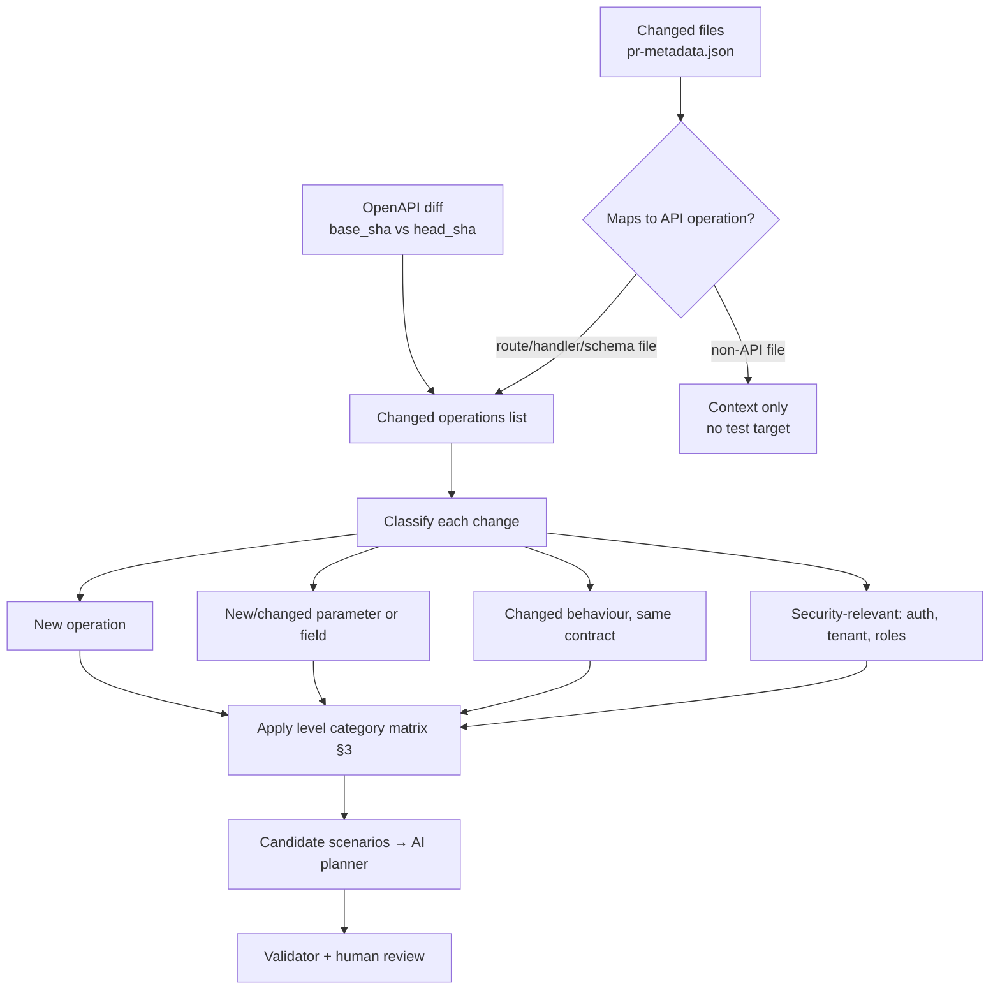
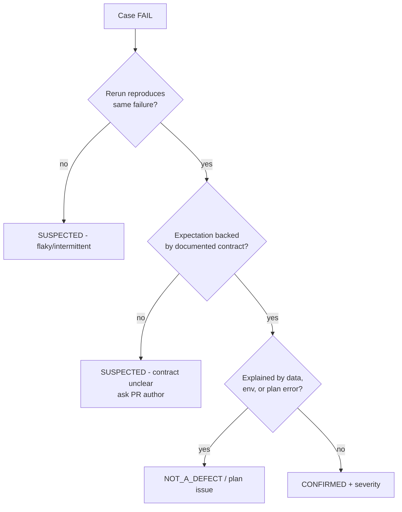

# QA Strategy

What PR QA Pilot tests, how much it tests at each level, and what has to be true before a result is called a bug.

> Status: Planned — documentation only (v0.1, 2026-10-18)

## Contents

1. [Testing philosophy](#1-testing-philosophy)
2. [What is and is not tested](#2-what-is-and-is-not-tested)
3. [Test levels](#3-test-levels)
4. [Scenario categories](#4-scenario-categories)
5. [Scenario selection](#5-scenario-selection)
6. [Assertions](#6-assertions)
7. [Regression policy](#7-regression-policy)
8. [Bug confirmation requirements](#8-bug-confirmation-requirements)
9. [Severity classification](#9-severity-classification)
10. [Test data and environments](#10-test-data-and-environments)
11. [Coverage limitations](#11-coverage-limitations)

Related: [AI_TEST_PLAN_SPEC.md](./AI_TEST_PLAN_SPEC.md) · [REPORTING.md](./REPORTING.md) · [SECURITY.md](./SECURITY.md) · [DECISIONS.md](./DECISIONS.md)

---

## 1. Testing philosophy

1. **Black-box API testing of a deployed environment.** The system sends HTTP requests to an already running test or staging deployment. It never builds, installs or runs PR code ([ADR-010](./DECISIONS.md)).
2. **Change-driven scope.** Each run tests what the PR changed plus a small regression ring around it. It is not a full-suite replacement.
3. **The contract is the oracle.** Expected behaviour comes from the OpenAPI specification and documented business rules. The AI proposes and a human confirms. When the contract is silent, the result is an *observation*, not a failure.
4. **Deterministic verdicts.** PASS or FAIL is computed by fixed assertions. No AI judges responses.
5. **Evidence or it didn't happen.** Every FAIL carries sanitized request and response evidence. A defect is reported as CONFIRMED only after reproduction (§8).
6. **Safe by default.** Non-destructive, bounded request counts, non-production only, least-privilege test accounts.
7. **Small and readable.** curl plus Python assertions, no pytest ([ADR-003](./DECISIONS.md)). A plan is a readable JSON file a reviewer can understand in minutes.

## 2. What is and is not tested

| In scope | Out of scope (v1) |
|---|---|
| HTTP status codes, response JSON shape (schema), field values | UI and browser behaviour |
| Input validation, missing and null fields, boundaries | Load, stress and performance benchmarking |
| Authentication and authorization, tenant isolation | Running unit or integration tests from the repository |
| Pagination, filtering, sorting where documented | Database-level checks (migrations, constraints not exposed by the API) |
| Error handling (no unexpected 5xx), HTTP method handling | Fuzzing at scale, exploit development |
| Regression of touched endpoints | Production monitoring |
| Safe negative security checks | Testing endpoints not in the project allowlist |
| Idempotency and light rate-limit behaviour where documented | Destructive tests, unless explicitly approved (§10) |

## 3. Test levels

Levels map to GitHub labels. The label is read in Phase 6 and acted on automatically in Phase 9. Before that, the level is chosen in the manual n8n trigger.

| Label | Purpose | Typical categories | Max requests\* | Target runtime | Approval |
|---|---|---|---|---|---|
| `qa-test:smoke` | Confirm changed endpoints are reachable and the main path works | happy_path, authentication (one negative), schema on 2xx | 15 | ≤ 2 min | Human in v1. May be auto-approved after Phase 9 if validation is clean `[Needs approval]` |
| `qa-test:standard` | Default for feature PRs: correctness of the change and its validation, plus regression of the touched area | smoke + validation, missing_null, authorization, tenant_isolation, schema, regression, error_handling | 60 | ≤ 10 min | Human review |
| `qa-test:comprehensive` | Larger or riskier changes, release candidates | standard + boundary, pagination_filtering, business_rule, method_handling, idempotency | 200 | ≤ 30 min | Human review |
| `qa-test:security` | Safe negative security probing of changed endpoints | authentication, authorization, tenant_isolation, security_negative, rate_limit, method_handling | 100 | ≤ 20 min | **Mandatory** human approval, `staging`/`local` only |

\* The budget counts every HTTP request, including retries. The effective limit is the **lower** of the level budget and the project's `limits.max_requests_per_run` in `projects.yaml` (policy rule POL-04 in [AI_TEST_PLAN_SPEC.md](./AI_TEST_PLAN_SPEC.md#63-stage-3-policy-semantic-project-aware)).

Additional rules:

- If a PR has several `qa-test:*` labels, the highest level wins, except that `security` always runs as its own separate run.
- Runtime targets are design goals, not measured values. They will be validated in Phase 10.
- Requests are sent sequentially by default, with a pause of ≥ 100 ms between requests (configurable per project). There is no parallelism in v1.

## 4. Scenario categories

The `category` enum in the plan schema:

| Category | What it verifies | Example (acme-orders PR #42) | Applies when |
|---|---|---|---|
| `happy_path` | Documented successful behaviour of the change | `GET /v1/orders?status=open` → 200 | Always, for changed operations |
| `validation` | Invalid formats or enums are rejected with 4xx and an error body | `status=not-a-status` → 400/422 | New or changed parameters or body fields |
| `missing_null` | Required fields absent or `null` | Cancel with `{}` → 400/422 | New required fields |
| `boundary` | Limits at min−1, min, max, max+1 | `reason` of 500 vs 501 characters | Documented `minLength`/`maxLength`/`minimum`/`maximum`/`maxItems` |
| `pagination_filtering` | `limit`/`cursor`/`page`, filters, sorting | `limit=1` returns ≤ 1 item | List endpoints touched |
| `authentication` | Missing, invalid or expired credentials → 401 | Anonymous list → 401 | Secured operations touched |
| `authorization` | Insufficient role → 403 | Viewer role cancels → 403 | Role-guarded operations |
| `tenant_isolation` | Tenant B cannot read or modify tenant A data (403/404, no data leak) | Tenant B cancels A's order → 403/404 | Multi-tenant resources touched |
| `method_handling` | Unsupported methods → 405, OPTIONS/HEAD behaviour | `PUT /v1/orders/{id}/cancel` → 405 | Routing changes |
| `schema` | Response matches the OpenAPI schema | List matches `OrderList` | Any 2xx with a documented schema |
| `business_rule` | Domain rules visible through the API | Filtered items have the requested status | Logic changes |
| `regression` | Previously working behaviour of touched endpoints unchanged | Unfiltered list still 200 | Modified (not new) operations |
| `error_handling` | No unexpected 5xx, consistent error envelope | Malformed JSON body → 400, not 500 | Any change to parsing or handlers |
| `rate_limit` | Documented limits answer 429 with `Retry-After` | ≤ documented limit + 1 requests | Only if limits are documented and the level allows it |
| `idempotency` | Repeating a request with the same idempotency key has no extra effect | Second identical cancel → same result | Documented idempotency semantics |
| `security_negative` | Injection-shaped input is handled safely (rejected or escaped, no 5xx, no reflection of internals) | `status=' OR 1=1--` → 400/422 | `security` level only |

`security_negative` inputs are fixed, harmless strings: SQL- or NoSQL-shaped literals, `<script>` markup, path-traversal-shaped values inside **parameters**, over-long strings, unicode edge cases. They check that input is *handled*. They never attempt exploitation, time-based probing, or payloads that could change data.

## 5. Scenario selection

Scope is derived, not assumed. The pipeline:

### 5.1 Change-to-scenario matrix

| Change type (detected from diff + OpenAPI diff) | Minimum scenarios at `standard` |
|---|---|
| New operation | happy_path, schema, authentication, one validation per required input, tenant_isolation if the resource is tenant-scoped |
| New optional parameter or field | happy_path with it, regression without it, validation of an invalid value |
| New required field | missing_null, validation, boundary if limits are documented, happy_path |
| Changed response schema | schema on every changed 2xx response, regression for existing consumers |
| Auth, role or tenant logic touched | authentication, authorization, tenant_isolation (both directions where fixtures exist) |
| Error handling changed | error_handling, at least one malformed-input case |
| Refactor with no contract change | regression only (smoke-sized) |
| Docs or tests only | No API run. The run is closed as `SKIPPED: no API-relevant changes`. |

### 5.2 Prioritization

When the budget is tight, keep cases in this order:

1. P1 — happy path of each changed operation, authentication/tenant isolation on changed secured operations, new required-field validation.
2. P2 — boundaries, regression of unchanged-but-touched endpoints, schema on secondary responses.
3. P3 — method handling, extra filter combinations, observations.

### 5.3 Detection limitations

Route and handler detection uses file path heuristics and the OpenAPI diff. When the spec is missing or not updated in the PR, the context package says so. The planner must then list affected operations as `assumptions`, and the reviewer must confirm them.

## 6. Assertions

All assertions are evaluated by the runner. Operator semantics are defined in [AI_TEST_PLAN_SPEC.md §5.1](./AI_TEST_PLAN_SPEC.md#51-assertion-operators).

| Layer | Assertion | Notes |
|---|---|---|
| Transport | Response received, no TLS or DNS error, within `--max-time` | A failure here → ERROR (`TRANSPORT_ERROR`/`TIMEOUT`), never FAIL |
| Status | `expect.status` (int or list) | Always required |
| Headers | `Content-Type` and documented headers (`Location`, `Retry-After`) | Header names are case-insensitive |
| Schema | `expect.json_schema` (inline or OpenAPI `$ref`) | Validated with `jsonschema`. OpenAPI 3.0 `nullable` is translated `[Verify]` for 3.0 vs 3.1 differences. |
| Body values | `equals`, `exists`, `type_is`, `contains`, `length_*`, `gte`/`lte`, `matches_regex` | Targets stable fields only |
| Timing | `max_duration_ms` | Optional. Generous thresholds only (see §11). |
| Implicit | Any 5xx when the plan expects < 500 | Reported as FAIL with `failure_class: UNEXPECTED_5XX` |

Determinism rules:

- Don't assert on timestamps, generated ids, ordering or counts unless the contract guarantees them or the test controls the data.
- Use status-code **lists** (for example `[403, 404]`) where the contract legitimately allows either. Record the reason in `assumptions`.
- Every 2xx case should have a schema or at least one body assertion (validator warning WARN-04).

## 7. Regression policy

| Rule | Detail |
|---|---|
| R1 Regression ring | For each **modified** operation, at least one case calls it the way it worked before the change (no new params or fields). |
| R2 Saved regression packs (Phase 7+) | After a PR merges, P1 cases that passed can be promoted to `config/regression/<project_id>/<operation>.json`, after human review. Future plans that touch the same operation include them. |
| R3 Base comparison (optional) | Where a base-branch environment exists, the same request can be sent to both. Differences are reported as observations, never as automatic FAILs. `[Recommendation]`, Phase 8+. |
| R4 Flaky handling | A case that both passes and fails across reruns without code changes is marked `flaky` in the report, kept out of CONFIRMED findings, and gets a stability ticket. |
| R5 No silent pruning | Removing a case from a regression pack needs a reason recorded in the pack's `changelog`. |

## 8. Bug confirmation requirements

The report separates **test results** (PASS/FAIL/ERROR/BLOCKED/SKIPPED, per case) from **findings** (possible defects, with a confidence level). An AI saying "this is a bug" is never enough.

### 8.1 Confidence levels

| Confidence | All of these must hold |
|---|---|
| `CONFIRMED` | (1) The case FAILed on a deterministic assertion. (2) A rerun of the same case against the same `head_sha` and environment failed the same way — **2 of 2** attempts, rerun automatically once at the end of the run. (3) The expectation is backed by the documented contract (OpenAPI, spec text or an explicit business rule), cited in the finding. (4) Sanitized request and response evidence is attached. (5) The failure is not explained by test data, environment or plan error. |
| `SUSPECTED` | Any of: a single occurrence or inconsistent reproduction, an ambiguous or undocumented contract, an expectation that came only from the AI plan, an environment that was unstable during the run, or a finding inferred from an observation rather than an assertion. |
| `NOT_A_DEFECT` | After triage: wrong expectation in the plan, fixture problem, environment issue, or behaviour confirmed as intended. Kept in history for learning. |

### 8.2 What is never a product finding

| Result | Classification | Report section |
|---|---|---|
| ERROR (`TRANSPORT_ERROR`, `TIMEOUT`, `ENVIRONMENT_UNAVAILABLE`) | Environment or infrastructure issue | "Execution problems" |
| BLOCKED (`AUTH_SETUP_FAILED`, `DEPENDENCY_FAILED`, `POLICY_BLOCKED`) | Setup or policy | "Not executed" |
| FAIL where the plan's expectation contradicts the contract | Test-design issue → plan fix | "Plan issues" |
| `RUNNER_ERROR` | Bug in PR QA Pilot itself | "Execution problems", runner issue opened |

### 8.3 Triage flow

A human may change confidence during report review, for example SUSPECTED → CONFIRMED after checking with the PR author. The override is recorded with name and reason in `result.json`.

## 9. Severity classification

Severity is assigned **only to findings** and only when evidence supports it. SUSPECTED findings carry a *provisional* severity, marked `(provisional)`.

| Severity | Definition | Examples |
|---|---|---|
| **S1 Critical** | Security or data-integrity failure, or a core operation completely broken | Cross-tenant data read or modification, authentication bypass, a secret in a response, data loss through a non-destructive call |
| **S2 High** | A changed feature does not work as documented for normal use, or there is an authorization gap with limited exposure | Filter ignored and all statuses returned, a required field not enforced, 5xx on valid input, a broken response schema for existing consumers |
| **S3 Medium** | Incorrect behaviour in edge or error paths with a workaround | Wrong 4xx code (500 vs 422 is S2; 400 vs 422 is S3), boundary off by one, inconsistent error envelope |
| **S4 Low** | Cosmetic or minor contract drift with no functional impact | Wrong `Content-Type` charset, an undocumented extra field, a typo in an error message |

Rules:

- Any CONFIRMED `tenant_isolation` or `authentication` failure is at least S2. If data from another tenant is returned, it is S1.
- `UNEXPECTED_5XX` on valid input is at least S2. On invalid input it is S3 unless it leaks internals (stack traces, SQL), which is S2.
- Discord notifications include only CONFIRMED S1/S2 counts by default ([REPORTING.md](./REPORTING.md)).

## 10. Test data and environments

| Topic | Policy |
|---|---|
| Environments | Each project declares an `environment` in `projects.yaml`: `local` or `staging`. `production` is rejected by the config loader in v1 ([SECURITY.md](./SECURITY.md)). |
| Accounts | Dedicated QA accounts per tenant (`tenant_a_user`, `tenant_b_user`, role variants). Tokens come from env vars `QA_<PROJECT>_<PROFILE>_TOKEN` and have the narrowest role that still allows the test. |
| Fixtures | Pre-seeded, documented fixtures (for example `ord_fixture_open_001`) listed in `projects.yaml` and given to the planner by id only |
| Data creation | Allowed when it is non-destructive and tagged (for example `"reason": "qa-…"` or an `X-QA-Run-Id` header if the API supports it). Records are cleaned up when the project defines `cleanup` steps. |
| Destructive tests | Off by default. Need project `destructive_tests_allowed: true` **and** per-run approval with `destructive_allowed: true`, against an isolated, resettable environment only. |
| Request pacing | Sequential, ≥ 100 ms apart, hard budget per level. Rate-limit tests stop at the first 429. |

## 11. Coverage limitations

State these in every report's "Limitations" section ([REPORTING.md](./REPORTING.md)):

1. **Change-scoped, not exhaustive.** Untouched endpoints are not tested beyond the regression ring. A passing run does not mean the API is defect-free.
2. **Black-box only.** Internal side effects (database state, queues, emails) are invisible unless the API exposes them.
3. **Contract-dependent.** If the OpenAPI spec is missing, outdated or changed by the same PR, expectations are weaker and more findings stay SUSPECTED.
4. **Planner quality.** AI-generated plans can miss scenarios or contain wrong expectations. Human review reduces this but does not remove it.
5. **Environment fidelity.** Staging may differ from production in data, configuration, feature flags and scale.
6. **Timing assertions are coarse.** One sequential client on a shared environment measures nothing reliable about performance. `max_duration_ms` only catches gross regressions.
7. **Security level is shallow by design.** It checks safe negative behaviour, not resistance to a determined attacker. It is not a penetration test.
8. **Version 1.0 assertion limits.** There are no wildcard JSONPath assertions yet, so "every item satisfies X" checks are limited (planned for schema 1.1, see [AI_TEST_PLAN_SPEC.md §11](./AI_TEST_PLAN_SPEC.md#11-versioning)).
9. **Sequential dependencies.** If a fixture or prerequisite case fails, dependent cases are BLOCKED and their scenarios stay unverified.
