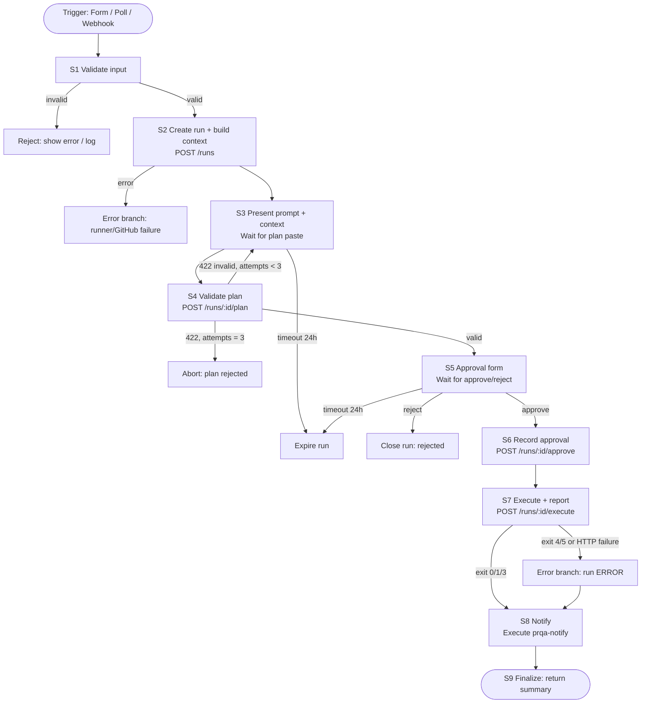
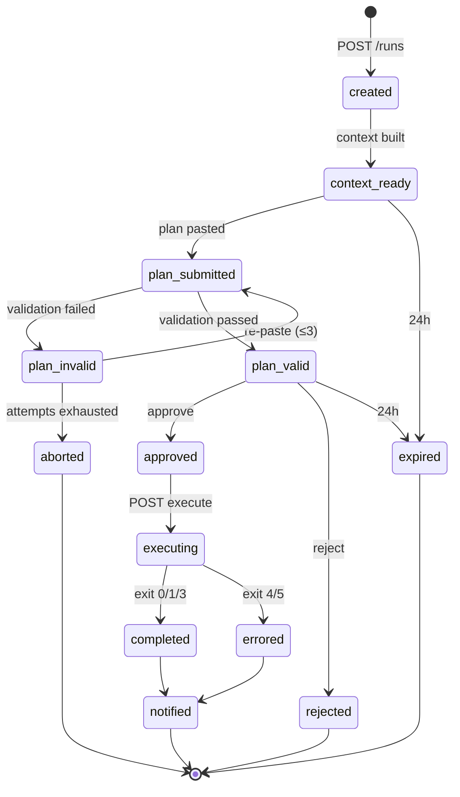

# Workflow Design

This document gives the n8n workflow design for PR QA Pilot: stages, inputs and outputs, error branches, retries, state, approval points, and node-by-node implementation guidance.

> Status: Planned — documentation only (v0.1, 2026-10-18)

## Table of Contents

1. [Design Principles](#1-design-principles)
2. [Workflow Inventory](#2-workflow-inventory)
3. [Main Workflow Stages](#3-main-workflow-stages)
4. [Stage Inputs and Outputs](#4-stage-inputs-and-outputs)
5. [Error Branches](#5-error-branches)
6. [Retry Rules](#6-retry-rules)
7. [Timeouts](#7-timeouts)
8. [Workflow State Management](#8-workflow-state-management)
9. [Manual Approval Points](#9-manual-approval-points)
10. [Node-by-Node Implementation Guidance](#10-node-by-node-implementation-guidance)
11. [Command Execution Nodes: Security](#11-command-execution-nodes-security)
12. [Credentials in n8n](#12-credentials-in-n8n)
13. [Exporting and Version-Controlling Workflows](#13-exporting-and-version-controlling-workflows)
14. [Transition to GitHub-Triggered Execution](#14-transition-to-github-triggered-execution)

---

## 1. Design Principles

- **n8n orchestrates and the runner executes** ([ADR-001](./DECISIONS.md#adr-001), [ADR-002](./DECISIONS.md#adr-002)). n8n never runs `curl` or shell commands. It calls `qa-runner serve` over HTTP on the internal network.
- **One main workflow for all projects.** Project-specific behavior comes from `config/projects.yaml` ([ADR-011](./DECISIONS.md#adr-011)), not from duplicated workflows.
- **Triggers are swappable.** Manual Form, Schedule (polling), and Webhook triggers all feed the same "Start Run" sub-workflow with an identical input contract.
- **All inputs are untrusted** until validated, including values typed into n8n forms.
- **The runner is the source of truth for run state** (`runs/<run_id>/`). n8n keeps only the `run_id` and the current stage.

---

## 2. Workflow Inventory

| Workflow (export file) | Purpose | Trigger | Introduced in phase |
|---|---|---|---|
| `prqa-main.json` | Context, plan, validation, approval, execution, report, notify | Execute Workflow (called by trigger workflows) | 4 |
| `prqa-trigger-manual.json` | Form for `project_id`, `pr_number`, `test_level` | n8n Form Trigger / Manual Trigger | 4 |
| `prqa-notify.json` | Render and send the Discord message, with retries | Execute Workflow | 5 |
| `prqa-error-handler.json` | Global error workflow: logs, Discord alert (sanitized) | Error Trigger | 4 |
| `prqa-trigger-poll.json` | Poll allowlisted repos for `qa-test:*` labels | Schedule Trigger (every 5 min) | 6–7 |
| `prqa-trigger-webhook.json` | Receive signed GitHub `pull_request` `labeled` events | Webhook | 9 |

Exports live in `n8n/workflows/` (see [§13](#13-exporting-and-version-controlling-workflows)). A compact outline is in [examples/n8n-workflow-outline.md](./examples/n8n-workflow-outline.md).

---

## 3. Main Workflow Stages



---

## 4. Stage Inputs and Outputs

| Stage | n8n node(s) | Input | Output | Success condition |
|---|---|---|---|---|
| S0 Trigger | Form Trigger / Schedule / Webhook | User form fields, poll result, or GitHub event | `{project_id, pr_number, test_level, trigger_source, requested_by}` | Event received |
| S1 Validate input | `Code` (JS, no external calls) + `If` | Trigger output | Same object, normalized | `project_id` matches `^[a-z0-9-]{1,40}$`; `pr_number` is an integer from 1 to 10^7; `test_level` ∈ {smoke, standard, comprehensive, security} |
| S2 Create run | `HTTP Request` → `POST /runs` | Validated input | `{run_id, head_sha, prompt_text, context_files[], allowed_levels}` | HTTP 201 |
| S3 Plan intake | `Wait` (On form submitted) / Form node | `prompt_text` displayed to user | `{plan_json_text}` | Form submitted within 24 h |
| S4 Validate plan | `HTTP Request` → `POST /runs/{run_id}/plan` | `plan_json_text` | `{valid, errors[], summary{cases, methods, destructive_count, est_requests}}` | HTTP 200 and `valid=true` |
| S5 Approval | `Wait` (On form submitted) | Plan summary | `{decision: approve\|reject, approved_by, allow_destructive: bool, comment}` | Form submitted |
| S6 Record approval | `HTTP Request` → `POST /runs/{run_id}/approve` | Decision | `{plan_sha256, approved_at}` | HTTP 200 |
| S7 Execute | `HTTP Request` → `POST /runs/{run_id}/execute` (timeout per level) | `run_id` | `{exit_code, overall_status, counts{pass,fail,error,blocked,skipped}, report_md_path, result_json_path}` | HTTP 200 (any of exit 0/1/3) |
| S8 Notify | `Execute Workflow` → `prqa-notify` | `run_id` | `{notification_status}` | Discord returns 2xx, or recorded failure |
| S9 Finalize | `Set` | All above | Final summary object | — |

The `Wait` node's "On form submitted" resume mode, and the Form node's ability to show dynamic text such as the prompt, must be confirmed against the pinned n8n version. `[Verify]` If displaying long prompt text in the form proves impractical, S3 should instead show a link or path to `runs/<run_id>/context/prompt.md`, and the user copies it from there.

---

## 5. Error Branches

| Error | Where | Branch behavior | User-visible result |
|---|---|---|---|
| Invalid trigger input | S1 | Stop. Form trigger: respond with the validation message. Poll/webhook: log and skip | "Invalid input: …" |
| Project disabled / level not allowed | S2 (runner returns 409) | Stop and log | "Project not enabled for this level" |
| GitHub unreachable / PR not found | S2 (runner returns 502/404) | Node retry (see §6), then error handler | Discord alert (no details beyond repo/PR) |
| Plan JSON invalid / unsafe | S4 (422) | Loop back to S3 showing `errors[]`; max 3 attempts tracked in workflow data | Error list in form |
| Approval rejected | S5 | Close run with `state=rejected`; no execution | Optional Discord "rejected" info |
| Wait timed out | S3/S5 | Close run with `state=expired` | Optional Discord info |
| Runner execution exit 4/5 | S7 | Mark run `ERROR`, go to notify with error summary | Discord: "Run ERROR (runner/config)" |
| HTTP timeout calling runner | S7 | Do **not** retry execute (non-idempotent). Query `GET /runs/{run_id}` to see whether it is still running | Discord alert if status is unknown |
| Discord failure | S8 | Retry, then record `notification_failed`; never fail the run | Visible in run summary and n8n execution log |
| Unhandled node error | any | Workflow setting "Error workflow" → `prqa-error-handler` | Sanitized Discord alert with `run_id` and n8n execution ID |

The error handler must not include raw error messages from the runner or GitHub in Discord, because they can contain URLs or tokens. It sends `run_id`, stage, error category, and n8n execution ID only.

---

## 6. Retry Rules

| Operation | Idempotent? | Retry policy | Configured in |
|---|---|---|---|
| `POST /runs` (context build) | Yes (same PR, same head SHA → overwrite context) | 3 tries, 5 s wait | HTTP node "Retry On Fail" |
| `POST /runs/{id}/plan` | Yes | 2 tries, 3 s wait (transport errors only) | HTTP node |
| `POST /runs/{id}/approve` | Yes (same hash) | 2 tries, 3 s wait | HTTP node |
| `POST /runs/{id}/execute` | **No** | **No automatic retry.** On timeout, poll `GET /runs/{id}` | Workflow logic |
| Per-request transport retries | Only GET/HEAD/OPTIONS | Max 2, backoff 2 s → 4 s | Runner (not n8n) |
| Environment unavailable (runner returns all BLOCKED/`ENVIRONMENT_UNAVAILABLE`) | Yes | 1 run-level retry after 60 s, as a fresh execute with `--force-rerun` | Workflow logic (If + Wait) |
| Discord webhook | Mostly (risk of duplicate message) | 3 tries, 10 s wait. On HTTP 429, honor `retry_after` from the Discord response | `prqa-notify` |
| GitHub polling | Yes | Next schedule tick acts as the retry | Schedule |

Rule: **orchestration retries never re-execute test requests that might change data.** Assertion failures are never retried. Confirmation re-runs for FAIL findings are a separate, explicit step (see [QA_STRATEGY.md](./QA_STRATEGY.md)).

---

## 7. Timeouts

| Step | Timeout | Notes |
|---|---|---|
| S2 context build | 120 s | Large diffs are truncated by the runner |
| S3 plan intake | 24 h | Run expires afterward |
| S5 approval | 24 h | Run expires afterward |
| S7 execute: smoke | 5 min | Target runtime ≤ 2 min |
| S7 execute: standard | 15 min | Target ≤ 10 min |
| S7 execute: comprehensive | 40 min | Target ≤ 30 min |
| S7 execute: security | 30 min | Target ≤ 20 min |
| Per test request | `request_timeout_s` from `projects.yaml` (default 15 s) | Enforced by curl `--max-time` |
| Whole n8n execution | Set `EXECUTIONS_TIMEOUT` / per-workflow timeout above the longest stage | `[Verify]` variable names for the pinned n8n version |

---

## 8. Workflow State Management

**Source of truth:** `runs/<run_id>/state.json` is written by the runner. n8n execution data is a convenience view.



- **Plan-attempt counter:** kept in the runner's `state.json` and echoed to n8n, so it survives n8n restarts.
- **Duplicate-run prevention (from Phase 6):** the runner computes `dedupe_key = <repository>#<pr>@<head_sha>:<test_level>` and refuses a new run when a non-terminal run with the same key exists (HTTP 409 with the existing `run_id`).
- **n8n execution data retention:** configure pruning (`EXECUTIONS_DATA_PRUNE`, `EXECUTIONS_DATA_MAX_AGE`) so that execution logs, which can contain pasted plans, do not grow without bound. `[Verify]` variable names.
- **Restart safety:** n8n persists waiting executions in its database under the `n8n_data` volume, so a waiting approval survives a container restart. `[Verify]` on the pinned version during Phase 4 acceptance.

---

## 9. Manual Approval Points

| Point | Stage | Who | Required when | What is shown | Recorded as |
|---|---|---|---|---|---|
| A1 Plan intake | S3 | QA engineer | Always while provider = `manual` | Prompt + context file paths | Plan text stored as `plan.submitted-<n>.json` |
| A2 Plan approval | S5 | QA engineer (not the PR author, `[Recommendation]`) | Always, except `qa-test:smoke` after Phase 9 with a valid plan | Case count, methods, endpoints, `destructive_count`, estimated requests vs. budget | `approval.json` with `plan_sha256` |
| A3 Destructive opt-in | S5 checkbox | QA engineer | Plan contains `destructive: true` cases | List of destructive cases | `approval.destructive_allowed=true`; without it those cases become BLOCKED (`POLICY_BLOCKED`) |
| A4 Security level | S5 | QA lead | `test_level=security` | Same + target environment confirmation | Same; runner refuses security runs without approval |
| A5 Confirmation re-run | Post-S8 (optional) | QA engineer | A FAIL is to be marked `CONFIRMED` | Failed case IDs | `result.rerun-<n>.json` |

Approval is bound to the exact plan bytes. If the plan changes, the hash differs, and the runner refuses to execute ([ADR-008](./DECISIONS.md#adr-008)).

---

## 10. Node-by-Node Implementation Guidance

The table below describes `prqa-main` plus the manual trigger. Node names are the suggested display names in n8n.

| # | Node name | Node type | Key configuration |
|---|---|---|---|
| 1 | `Form: Start QA Run` | n8n Form Trigger | Fields: `project_id` (dropdown, values copied from enabled projects), `pr_number` (number), `test_level` (dropdown). Authentication: n8n user / basic auth. Path: random |
| 2 | `Validate Input` | Code (JavaScript) | Regex/enum checks from §4; throw an error with a user-friendly message when invalid. No HTTP calls |
| 3 | `Create Run` | HTTP Request | `POST http://qa-runner:8080/runs`; header `X-Runner-Token` from n8n credential (Header Auth); JSON body from node 2; Retry On Fail 3×/5 s; timeout 120 s |
| 4 | `Show Prompt & Wait for Plan` | Form (Next form page) or Wait (On form submitted) | Show `prompt_text` (or the file path), one textarea `plan_json`. Limit wait time 24 h |
| 5 | `Submit Plan` | HTTP Request | `POST /runs/{{$json.run_id}}/plan`, raw body = pasted text (the runner parses it; n8n does not `eval`). Settings: "Never error" so 422 is handled by node 6 |
| 6 | `Plan Valid?` | If | `{{$json.valid}} === true`; false branch → node 6a |
| 6a | `Attempts Left?` | If | `{{$json.attempt}} < 3` → back to node 4 with `errors[]` shown; else → `Close: Aborted` |
| 7 | `Approval Form` | Wait (On form submitted) | Displays `summary`; fields: decision, approved_by, allow_destructive (checkbox), comment. 24 h limit |
| 8 | `Approved?` | If / Switch | approve → node 9; reject → `Close: Rejected` |
| 9 | `Record Approval` | HTTP Request | `POST /runs/{id}/approve`; retry 2× |
| 10 | `Execute Plan` | HTTP Request | `POST /runs/{id}/execute`; timeout by level (expression mapping); **Retry On Fail: off** |
| 11 | `Env Unavailable?` | If | `overall_status == "BLOCKED"` and `blocked_reason == "ENVIRONMENT_UNAVAILABLE"` and not yet retried → Wait 60 s → node 10 with `force_rerun=true` |
| 12 | `Notify` | Execute Workflow | Calls `prqa-notify` with `run_id` |
| 13 | `Final Summary` | Set | Return `run_id`, status, counts, report paths |

`prqa-notify`:

| # | Node | Type | Configuration |
|---|---|---|---|
| 1 | `Start` | Execute Workflow Trigger | Input: `run_id` |
| 2 | `Get Payload` | HTTP Request | `GET /runs/{id}/notification` (runner renders sanitized Discord JSON) |
| 3 | `Send to Discord` | HTTP Request | `POST` to the webhook URL stored in an n8n credential (not hard-coded); body = payload; Retry 3×/10 s |
| 4 | `Record Result` | HTTP Request | `POST /runs/{id}/notification-status` |

Why the runner renders the Discord payload: redaction and truncation rules live in one tested place, and n8n only transports the message.

---

## 11. Command Execution Nodes: Security

n8n's **Execute Command** node runs arbitrary shell commands inside the n8n container with n8n's privileges and filesystem access. Any user who can edit workflows, or anyone who can inject data into a command string, could:

- read `/home/node/.n8n` (database, encryption key file) and environment variables,
- reach any network the n8n container can reach,
- escalate further if the Docker socket or host paths are mounted.

**Facts.** According to the n8n documentation on blocking nodes, n8n disables Execute Command and Local File Trigger by default in current versions (v2.x). They are controlled through the `NODES_EXCLUDE` environment variable, and setting `NODES_EXCLUDE` to `"[]"` re-enables them. `[Verify]` against your pinned version: <https://docs.n8n.io/hosting/securing/blocking-nodes/>

**Policy for this project** `[Recommendation]`:

1. Keep Execute Command disabled. Set it explicitly so that defaults changing between versions cannot silently re-enable it:
   ```yaml
   environment:
     - NODES_EXCLUDE=["n8n-nodes-base.executeCommand","n8n-nodes-base.localFileTrigger"]
   ```
   `[Verify]` exact JSON quoting in Compose for the pinned version.
2. Do not use the `Code` node to spawn processes. Use it only for pure data transformation.
3. Never mount `/var/run/docker.sock` or host directories other than the n8n data volume into n8n.
4. All execution goes through `qa-runner serve`, which exposes a **fixed set of operations** (§10 / [ARCHITECTURE.md §6](./ARCHITECTURE.md#6-integration-boundaries)) and never accepts commands, URLs, or hosts from the request body that bypass `projects.yaml` policy.
5. Restrict n8n accounts: a single owner account locally, with no shared editor accounts.

---

## 12. Credentials in n8n

| Credential | n8n credential type | Used by | Notes |
|---|---|---|---|
| Runner shared token | Header Auth (`X-Runner-Token`) | All runner HTTP nodes | Same value as `QA_RUNNER_SHARED_TOKEN` in the runner env |
| Discord webhook | Store the URL in a credential, for example Header Auth with the URL in a custom field or a generic credential `[Verify]` best credential type | `prqa-notify` | Never paste into node parameters, which end up in exports |
| GitHub (webhook secret, Phase 9) | Used by a Code node to verify `X-Hub-Signature-256` | `prqa-trigger-webhook` | The PAT itself stays in the runner only |

n8n encrypts stored credentials with `N8N_ENCRYPTION_KEY`. Back up this key separately. Without it, the credentials cannot be decrypted after restore (see [DEPLOYMENT.md](./DEPLOYMENT.md)).

---

## 13. Exporting and Version-Controlling Workflows

Workflows are exported as JSON into `n8n/workflows/` and committed. Credentials are **not** exported, or only in encrypted form, which is not committed.

```bash
# Export all workflows as separate files from the running container
docker compose -f compose/docker-compose.yml exec n8n \
  n8n export:workflow --all --separate --output=/home/node/.n8n/exports/
docker compose -f compose/docker-compose.yml cp \
  n8n:/home/node/.n8n/exports/. ./n8n/workflows/

# Import (e.g. on a fresh instance)
docker compose -f compose/docker-compose.yml cp ./n8n/workflows/. n8n:/home/node/.n8n/imports/
docker compose -f compose/docker-compose.yml exec n8n \
  n8n import:workflow --separate --input=/home/node/.n8n/imports/
```

`[Verify]` flags (`--all`, `--separate`, `--output`, `--input`) against the n8n CLI documentation for the pinned version.

Version-control rules:

- Before committing, check that exports contain no secrets: `grep -RniE 'discord(app)?\.com/api/webhooks|ghp_|github_pat_|Bearer ' n8n/workflows/` must return nothing.
- Normalize file names (`prqa-main.json`, …) and avoid committing per-export volatile fields where possible (for example IDs and timestamps) to keep diffs reviewable. `[Recommendation]`
- Change workflows in the UI, export them, and open a PR. The workflow JSON is reviewed like code.

---

## 14. Transition to GitHub-Triggered Execution

| Step | Phase | Trigger | Required before enabling |
|---|---|---|---|
| 1 | 4 | Manual Form | MVP criteria met |
| 2 | 6–7 | Schedule (every 5 min): runner `GET /poll` lists open PRs with `qa-test:*` labels in enabled repos | Read-only PAT; dedupe key; per-project enable flag |
| 3 | 9 | GitHub webhook `pull_request` (action `labeled`) | Public HTTPS ingress (reverse proxy or tunnel), `X-Hub-Signature-256` HMAC verification, delivery-ID dedupe (`X-GitHub-Delivery`), label allowlist, repo allowlist, rate limit |

Webhook handling rules:

1. Verify the HMAC-SHA256 signature over the raw body with the webhook secret **before** parsing. Reject on mismatch with 401.
2. Accept only `pull_request` events with `action=labeled` and a label in {`qa-test:smoke`, `qa-test:standard`, `qa-test:comprehensive`, `qa-test:security`}.
3. Accept only repositories enabled in `projects.yaml`.
4. Respond `202` immediately, then run asynchronously. Duplicate deliveries are dropped by `X-GitHub-Delivery` and by `dedupe_key`.
5. Fork PRs: the system only reads metadata and tests the deployed environment, so fork PRs do not get secrets. Whether fork PRs are eligible at all is a per-project setting (default: **not eligible**). `[Needs approval]`
6. Never use a GitHub Actions `pull_request_target` workflow that checks out and runs PR code ([ADR-010](./DECISIONS.md#adr-010), [SECURITY.md](./SECURITY.md)).

Comparison of polling, webhooks, and Actions: [DEPLOYMENT.md §3](./DEPLOYMENT.md#3-github-integration-options).
