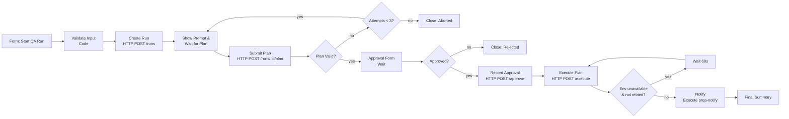

# Example: n8n Workflow Outline (`prqa-main`)

This illustrative outline of the main n8n workflow is a design aid, not an exported workflow file. It has not been built or executed.

> Status: Planned — documentation only (v0.1, 2026-10-18). Full design: [WORKFLOW_DESIGN.md](../WORKFLOW_DESIGN.md)

## Flow

## Node list

| # | Node | Type | Input (example) | Output (example) |
|---|---|---|---|---|
| 1 | Form: Start QA Run | Form Trigger | user fills form | `{"project_id":"acme-orders","pr_number":42,"test_level":"standard"}` |
| 2 | Validate Input | Code | node 1 | same object + `"trigger_source":"manual"` |
| 3 | Create Run | HTTP Request | node 2 | `{"run_id":"20261018T143000Z-acme-orders-pr42-a1b2c3d","head_sha":"a1b2c3d…","prompt_path":"runs/…/context/prompt.md"}` |
| 4 | Show Prompt & Wait for Plan | Wait / Form | prompt path or text | `{"plan_json":"{ … pasted … }"}` |
| 5 | Submit Plan | HTTP Request | pasted text | `{"valid":true,"attempt":1,"summary":{"cases":8,"methods":["GET","POST"],"destructive_count":0,"est_requests":9}}` |
| 6 | Plan Valid? | If | node 5 | true / false branch |
| 7 | Approval Form | Wait / Form | summary | `{"decision":"approve","approved_by":"qa.engineer","allow_destructive":false}` |
| 8 | Approved? | If | node 7 | branch |
| 9 | Record Approval | HTTP Request | decision | `{"plan_sha256":"<64-hex>","approved_at":"2026-10-18T14:41:02Z"}` |
| 10 | Execute Plan | HTTP Request (no auto-retry) | run_id | `{"exit_code":1,"overall_status":"FAIL","counts":{"pass":6,"fail":1,"error":0,"blocked":1,"skipped":0}}` |
| 11 | Env unavailable? | If | node 10 | branch |
| 12 | Notify | Execute Workflow | run_id | `{"notification_status":"sent"}` |
| 13 | Final Summary | Set | all | summary object |

All values above are illustrative placeholders. No run has taken place.

## Workflow settings

| Setting | Value |
|---|---|
| Error workflow | `prqa-error-handler` |
| Save successful executions | Yes, pruned per retention policy |
| Timezone | `GENERIC_TIMEZONE` |
| Timeout | Above the longest execute stage (≥ 45 min) `[Verify]` setting name |

## Credentials referenced (by name only)

- `PRQA Runner Token` (Header Auth `X-Runner-Token`)
- `PRQA Discord Webhook` (used in `prqa-notify`)
